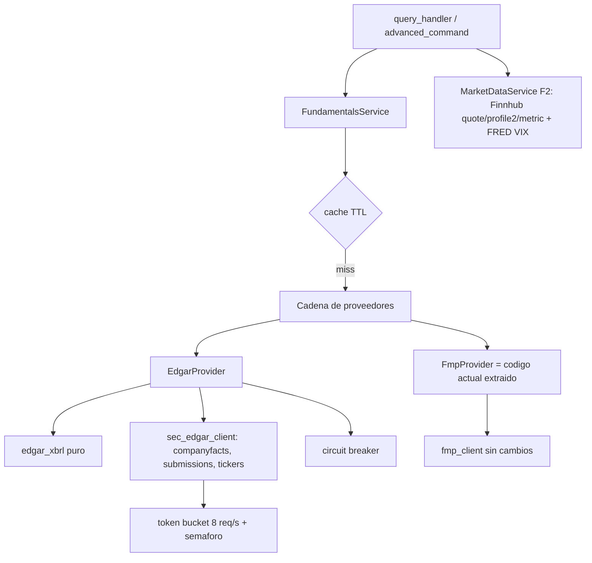

# Spec: Fuentes de datos gratuitas para InvestBot (SEC EDGAR primero, Finnhub después, FMP como respaldo) [Iter-1]

**Rol:** `architect` (spec base). **Destino sugerido:** `contexto/specs/abiertas/SDD_fuentes_datos_gratuitas.md`
**Pipeline:** BMAD + SDD + Ralph Loop. **Siguiente paso:** `security` (sección 5), `qa` (sección 7), luego `implementer` por fases. No hay `frontend`: el único cambio visible son líneas de procedencia y de N/D en el mensaje.
**Línea base medida hoy (2026-11-12):** `HEAD` real = `8b74b58` ("Improve prompt with two calls"), NO `502d5df` como figuraba en el pedido. `git status` está limpio (0 archivos modificados), así que el trabajo de redacción Gemini Iter-2 ya está commiteado. `pytest -q` da **2957 passed, 4 skipped**. Esta spec no toca ni depende de `ai_rewrite.py`, `gemini_client.py` ni de `SDD_redaccion_gemini_iter2.md`.

---

## 0. Resumen ejecutivo

- **Decisión recomendada (verificada, ver sección 1):** estados financieros desde **SEC EDGAR XBRL `companyfacts`** (oficial, gratis, sin key, 10 req/s, sin tope diario). Cotización/perfil/beta/52 semanas desde **Finnhub** (`/quote`, `/stock/profile2`, `/stock/metric`, todos sin marca "premium" en el swagger oficial). VIX desde **FRED `VIXCLS`** (ya hay `FRED_API_KEY`). **FMP queda como último respaldo.**
- **Tu recomendación previa se confirma con tres correcciones importantes**, todas observadas en datos reales del 2026-11-12/13:
  1. Los 10-Q traen el **flujo de caja solo acumulado (YTD)** y no existe el 4.º trimestre (Q4 = FY − 9M): hay que derivar trimestres discretos.
  2. Los tags XBRL **cambian entre empresas y entre años** (AAPL dejó de reportar `InterestExpense` en 2023; NVDA cambió de `PaymentsToAcquirePropertyPlantAndEquipment` a `PaymentsToAcquireProductiveAssets`; KO no tiene `Liabilities`). La regla "primer tag presente" es incorrecta: hay que resolver **por período** con una cascada de prioridad.
  3. **Splits:** NVDA mezcla EPS pre y post split dentro de la misma serie (0,82 en 2023-04-30 vs 0,25 en 2023-07-30). El EPS histórico no se puede usar tal cual.
- **Mínimo que destraba los 402 observados = Fase F1** (EDGAR para income / balance / cash-flow / métricas propias con FMP de respaldo). **F1 no arregla** el 402 "símbolo premium" de `/quote` (casos MELI/DRAM): eso necesita F2 (Finnhub).
- **Costo en código de F1:** hay que tocar 4 consumidores para que "dato ausente" deje de convertirse en 0 (interés, deuda, liquidez, margen bruto). Sin eso EDGAR degradaría el análisis de AAPL y fabricaría un WACC sin deuda (ver sección 3.6).

---

## 1. Investigación: qué hay realmente gratis hoy

Verificado = leído de la fuente oficial o respuesta real obtenida en esta investigación. Fechas: 2026-11-12/13. Las capturas reales las hizo este run con un User-Agent de investigación; el `implementer` debe recapturar con el UA de Daniela usando el script de la sección 7.

### 1.1 SEC EDGAR

| Hecho | Estado | Fuente |
|---|---|---|
| APIs en `data.sec.gov`: `submissions`, `companyconcept`, `companyfacts`, `frames`; sin autenticación ni API key | VERIFICADO | https://www.sec.gov/search-filings/edgar-application-programming-interfaces |
| Latencia: JSON actualizado "en tiempo real" (XBRL < 1 minuto, submissions < 1 s); ZIP masivos se republican de noche (~3:00 a.m. ET) | VERIFICADO | misma página |
| No soporta CORS (irrelevante: acceso desde servidor) | VERIFICADO | misma página |
| "Current maximum access rate is 10 requests per second"; declarar `User-Agent` con nombre + email de contacto; la SEC se reserva limitar | VERIFICADO | https://www.sec.gov/about/webmaster-frequently-asked-questions y https://www.sec.gov/search-filings/edgar-search-assistance/accessing-edgar-data |
| Sin restricción de uso comercial ni de redistribución en esas páginas; "todo contenido gubernamental y EDGAR es libre de acceder y reutilizar" | VERIFICADO (la política "Website Dissemination" enlazada no se pudo leer) | FAQ anterior |
| Qué pasa al exceder 10 req/s (bloqueo/403/429) | NO VERIFICADO (la página no lo dice) | tratar 403/429 como señal de bloqueo (circuit breaker, sección 4.7) |
| `companyfacts` real (gzip activo vía `Accept-Encoding`): AAPL 3,86 MB sin comprimir y **277 KB** por la red; NVDA 4,09 MB; ADBE 4,33 MB; KO 5,21 MB; **JPM 8,14 MB**; TSM 0,91 MB; MELI 3,96 MB | VERIFICADO (curl real) | `https://data.sec.gov/api/xbrl/companyfacts/CIK##########.json` |
| `submissions` AAPL: 164 KB; trae `name`, `sic`, `sicDescription`, `exchanges`, `tickers`, `entityType`, `fiscalYearEnd`, `filings.recent` | VERIFICADO | `https://data.sec.gov/submissions/CIK0000320193.json` |
| `company_tickers.json`: 10.405 entradas, 796 KB, campos `cik_str`, `ticker`, `title` (sin campo de bolsa). Usa guion para clases: **`BRK-B` existe, `BRK.B` no**. Contiene ETFs y extranjeras (SPY, TSM aparecen) | VERIFICADO | https://www.sec.gov/files/company_tickers.json |
| `companyfacts` de un ETF (SPY): **HTTP 404 con cuerpo XML `NoSuchKey`, no JSON** | VERIFICADO | curl real |
| `companyfacts` de TSM (20-F): solo namespaces `dei`, `ifrs-full`, `srt`, **sin `us-gaap`** | VERIFICADO | curl real |
| `companyfacts` de MELI (la que FMP bloquea con 402 en `/quote`): `us-gaap` completo, unidad USD, último dato 2026-09-30 | VERIFICADO | curl real |
| `frames` (un hecho para todas las empresas en un período): respuesta de ~500 KB, `pts` 3.803 para `AccountsPayableCurrent/USD/CY2019Q4I` | VERIFICADO | `https://data.sec.gov/api/xbrl/frames/us-gaap/AccountsPayableCurrent/USD/CY2019Q4I.json` |

**Decisión sobre `frames`:** NO se usa. Sirve para comparar muchas empresas en un período y cada llamada pesa ~0,5 MB; el bot consulta una empresa a la vez.

**Estructura real de un hecho (`units.USD[i]`):** `start` (solo en duraciones), `end`, `val` (dólares enteros, no miles), `accn`, `fy`, `fp`, `form`, `filed`, `frame` (opcional). Trampas reales confirmadas:
- `fy`/`fp` son el año fiscal **del filing, no del período**. El FY2025 de AAPL (`end` 2025-09-27) aparece con `fy=2025` en el 10-K de 2025-10-31 **y otra vez con `fy=2026`** en el 10-K de 2026-11-03 como comparativo. **Nunca asignar períodos con `fy`/`fp`; usar `start`/`end`.**
- Duplicados: el mismo `(start,end)` aparece en varios filings, a veces reexpresado. Regla: gana el `filed` más reciente.
- `frame` lo asigna la SEC a un solo duplicado por período: no sirve como clave.
- En un 10-Q de Q2 conviven el hecho de 3 meses (con `frame`) y el acumulado de 6 meses (sin `frame`, mismo `end`, distinto `start`).

### 1.2 Finnhub (swagger oficial leído de https://finnhub.io/static/swagger.json)

| Endpoint | Marca en el swagger | Campos útiles | Estado |
|---|---|---|---|
| `GET /quote` | sin `premium` ("High Usage") | `c` precio, `pc`, `h`, `l`, `o`, `d`, `dp`, `t` | Gratis según swagger. Que símbolo desconocido devuelva ceros: NO VERIFICADO |
| `GET /stock/profile2` | sin `premium` ("free version of Company Profile") | `name`, `ticker`, `exchange`, `country`, `currency`, `marketCapitalization` (millones), `shareOutstanding` (millones), `finnhubIndustry` (taxonomía propia, NO GICS) | Gratis según swagger |
| `GET /stock/metric?metric=all` | sin `premium` ("High Usage") | el sample oficial muestra `beta`, `52WeekHigh`, `52WeekLow`, series `annual`. El mapa `MetricMap` es un objeto libre | Nombres de claves como `peTTM`, `dividendYieldIndicatedAnnual`, `payoutRatioTTM`, `roeTTM`: **NO VERIFICADOS sin key real** |
| `GET /stock/financials-reported` | sin `premium` | XBRL "as reported" por filing (es el mismo dato de la SEC) | Sin ventaja sobre EDGAR directo (necesita key y gasta cupo). **No se usa.** |
| `GET /stock/financials` (estandarizado), `/stock/candle`, `/stock/profile`, `/stock/dividend`, `/stock/price-metric` | `Premium Access Required` | — | De pago. Sin velas gratis no hay SMA50/SMA200 |
| `GET /stock/peers`, `GET /search` | sin `premium` | `/search?q=` devuelve `description`, `displaySymbol`, `symbol`, `type` | Gratis según swagger; `/stock/peers` ya está en uso |

- **Límites:** 429 al exceder; además "30 API calls/second" sobre cualquier plan (https://finnhub.io/docs/api, sección Rate Limits). **60 llamadas/minuto en el plan gratuito: NO VERIFICADO en la doc oficial** (lo dicen fuentes de terceros y `.env.example`).
- **Autenticación:** el swagger declara `token` como query param, pero la doc oficial también acepta el header `X-Finnhub-Token` (VERIFICADO). Para no meter la key en URLs, las llamadas nuevas usan el header.
- **Términos** (https://finnhub.io/terms-of-service): "All plan listed on Finnhub website is strictly for personal use"; "You hereby agree to not redistribute or share access to data or derived results from the data" sin aprobación escrita; los términos pueden cambiar "without notice". **Riesgo real para este bot**, porque lo usan Daniela y hasta 2 personas más (ver P-5 y R-6). Además hay antecedente documentado en el repo (`finnhub_client.py`) de endpoints movidos a pago sin aviso.
- **Qué NO da Finnhub gratis:** promedios móviles de 50/200 días (velas son premium). El momentum del bot queda parcial (ver 3.8).

### 1.3 Otras fuentes evaluadas

| Fuente | Hallazgo | Veredicto |
|---|---|---|
| Twelve Data, plan Basic | 8 créditos/min, 800/día, solo EEUU, "internal, non-display" (https://twelvedata.com/pricing.md). Fundamentales no son Basic: `income_statement` cuesta 100 créditos, `balance_sheet` exige Pro, `profile` exige Grow (https://support.twelvedata.com/en/articles/5615854-credits). `time_series` cuesta 1 crédito | Descartado para estados. Candidato futuro solo para SMA50/200 vía `time_series` (la cláusula "non-display" está por aclarar; NO VERIFICADO si aplica a un bot de Telegram) |
| Alpha Vantage, free | "up to 25 requests a day" (https://www.alphavantage.co/support/); al limitar devuelve HTTP 200 con campo `Information`. Si `INCOME_STATEMENT`/`OVERVIEW` son gratis: NO VERIFICADO. Términos (https://alphavantage.co/terms_of_service) son un PDF que no pude leer: NO VERIFICADO | Descartado: 25/día no alcanza ni para un usuario activo |
| FRED `VIXCLS` | VERIFICADO: serie diaria de cierre del CBOE VIX, último dato 2026-11-11 = 17,49 (https://fred.stlouisfed.org/series/VIXCLS). Etiquetada "Copyrighted: Citation Required" | Reemplaza `/quote?symbol=^VIX` de FMP; hay que citar la fuente en el mensaje |
| Scraping | Ya evaluado y descartado en `contexto/referencia/evaluacion_scraping_datos_financieros.md` | Fuera de alcance |

### 1.4 Opciones y trade-offs

**Opción A: EDGAR primero, Finnhub para mercado, FMP de respaldo (RECOMENDADA)**
- Ventajas: oficial, sin key, sin tope diario, dato fresco (< 1 min tras el filing), cruza exacto con el fixture real de NVDA que ya está en el repo (sección 7), baja el consumo de FMP de ~11 a ~1 llamada por consulta al final.
- Desventajas: solo empresas de EEUU con `us-gaap` en USD; hay que mapear tags (trabajo real); hay que calcular en Python lo que FMP entrega precalculado; bancos y aseguradoras fuera en F1.
- Mejor cuando: la consulta típica es una empresa grande de EEUU (el caso de Daniela).

**Opción B: Finnhub `financials-reported` como fuente principal de estados**
- Ventajas: un solo proveedor.
- Desventajas: es el mismo dato XBRL pero con key, 60/min y términos de uso personal; no agrega nada sobre EDGAR directo.
- Mejor cuando: no existiera acceso directo a la SEC. Descartada.

**Opción C: pagar un plan de FMP**
- Contradice el pedido explícito de Daniela ("usá la forma gratuita"). Descartada.

---

## 2. Estado actual (leído del código)

### 2.1 Flujo y puntos de falla

- `src/investbot/fmp_client.py:33` base `https://financialmodelingprep.com/stable`; `_get` en 63-126 traduce todo error a `FMPError` sanitizado (402 con sub-caso `simbolo_premium`/`generico`, 429 cupo, 401/403 key). Endpoints: `/search-symbol`, `/quote`, `/profile`, `/income-statement`, `/balance-sheet-statement`, `/cash-flow-statement`, `/key-metrics`.
- `query_handler.py:202-296` (`fetch_and_analyze_parts`) pide por consulta: `/quote`, `/profile`, `/income-statement?period=quarter`, `/cash-flow-statement?period=quarter`, `/balance-sheet-statement?period=quarter&limit=1`, `/key-metrics?limit=1` (propio), `/quote?symbol=^VIX`. Trimestral primero; si el paquete no sirve cae a anual.
- **Hallazgo de causa raíz:** las 3 llamadas de **fallback anual** (`query_handler.py:222`, `:248`, `:268`) **no están dentro de `try/except`**. Con 402 en `/income-statement` el `FMPError` sube hasta `_run_analysis` (`query_handler.py:1072`) y el usuario recibe solo "no está disponible en el plan gratuito". Por eso los análisis salen incompletos o directamente no salen.
- `query_handler.py:894-899` usa `/search-symbol` para resolver texto libre a ticker; `FMPError` se muestra tal cual al usuario.
- `advanced_command.py:431-471` (`/avanzado`): `/profile` (con `isEtf`/`isFund`/`isActivelyTrading`), `/quote`, y los 3 estados **anuales con `limit=2`** (reciente y anterior).
- `peers.py` (`get_peer_pe_average`): por peer llama `/key-metrics?limit=1` y deriva PER = 1 / `earningsYield`. Un 402 o dato ausente deja al peer como `sin_dato`.
- Presupuesto actual (README sección "Plan de FMP"): 10-13 llamadas FMP por consulta típica (~19-25 consultas/día con 250/día); 13-16 en el peor caso.

### 2.2 Inventario EXACTO de campos que consume el bot (nombres FMP → significado → ¿derivable de XBRL?)

Quien consume cada campo está verificado por lectura de código. "Derivable" = sí con las reglas de la sección 3.

**Income statement** (`query_handler.py:240-350`, `rules.py`, `advanced_command.py:205-215`, `advanced_scoring.py`)

| Campo FMP | Significado | Consumidor | XBRL |
|---|---|---|---|
| `revenue` | Ingresos | `rules.calculate_gross_margin`, P/S, pilares, series de crecimiento, Piotroski, Altman (ventas/activos) | Sí |
| `costOfRevenue` | Costo de ventas | margen bruto, `rules.calculate_income_statement_ttm` | Sí (o `revenue − grossProfit`) |
| `grossProfit` | Utilidad bruta | Piotroski | Sí |
| `ebit` | Utilidad antes de intereses e impuestos | Altman (X3), Magic Formula | Sí, con definición propia (3.5) |
| `interestExpense` | Gasto por intereses | `wacc_inputs`, TTM atómico | **Parcial** (AAPL no lo reporta desde 2023) |
| `incomeTaxExpense` | Impuesto a las ganancias | WACC (tasa efectiva) | Sí |
| `incomeBeforeTax` | Utilidad antes de impuestos | WACC (tasa efectiva) | Sí |
| `netIncome` | Utilidad neta atribuible | EPS, ROE, pilares, Piotroski | Sí |
| `eps` | EPS básico | `rules.build_ttm_historial` (historial para CAGR de Graham) | Sí, con cuidado de splits (3.4) |
| `weightedAverageShsOutDil` / `weightedAverageShsOut` | Acciones promedio diluidas / básicas | `eps_ttm = net_income_ttm / shares` (`query_handler.py:314`), DCF por acción, Piotroski (básicas) | Sí |
| `date` | Fecha de cierre del período | `advanced_command.py:322` (texto) | Sí (`end`) |

**Balance** (`query_handler.py:304-306,414-415`, `advanced_scoring.py:118-171,535-539`, `advanced_command.py:205-208`)

| Campo FMP | Significado | XBRL |
|---|---|---|
| `totalCurrentAssets`, `totalCurrentLiabilities` | Liquidez, Altman, Piotroski, Magic | Sí (`AssetsCurrent`, `LiabilitiesCurrent`); **no existen en bancos** |
| `totalAssets`, `totalLiabilities` | Altman, Piotroski | Sí; `Liabilities` falta en KO (derivable) |
| `retainedEarnings` | Altman | Sí |
| `shortTermDebt`, `longTermDebt` | Total de deuda del WACC; Piotroski (`longTermDebt`) | Parcial: depende del tag (3.3) |
| `totalDebt` | EV de Magic Formula | Derivable (3.5) |
| `cashAndCashEquivalents` | EV de Magic Formula | Sí |
| `propertyPlantEquipmentNet` | Capital invertido de Magic Formula | Sí |
| `totalEquity` / `totalStockholdersEquity` | ROE de `/avanzado` | Sí |

**Cash flow** (`query_handler.py:239-243,357-361`, `advanced_scoring.py:341`)

| Campo FMP | Significado | XBRL |
|---|---|---|
| `operatingCashFlow` | Flujo operativo | Sí (`NetCashProvidedByUsedInOperatingActivities`), pero **solo YTD en los 10-Q** |
| `capitalExpenditure` | Capex (FMP lo entrega negativo; el bot hace `abs()`) | Sí (`PaymentsToAcquirePropertyPlantAndEquipment` o `PaymentsToAcquireProductiveAssets`); también YTD |

**Key-metrics propio** (`rules.extract_key_metrics_extras`, `peers.py`)

| Campo | Uso | XBRL |
|---|---|---|
| `roe`, `debtToEquity`, `netDebtToEBITDA`, `dividendYield`, `payoutRatio` | Sección de "extras" del mensaje | **No existen en XBRL**: se calculan en Python (3.5) |
| `earningsYield` (de peers) | PER del peer = 1/earningsYield | Se calcula con precio y utilidad TTM (F2) |

**Profile** (`query_handler.py:298-300`, `advanced_command.py:90-103,160-165`): `companyName`, `sector` (debe ser un nombre de `_SECTOR_ALLOWLIST` de `ai_explain.py`), `industry` (palabras clave de `is_asset_light`; no viaja a Gemini), `beta`, `price`, `marketCap`, `isEtf`/`isFund`/`isActivelyTrading`.
**Quote** (`query_handler.py:301-302,465-471`, `market_context.py:80`): `price`, `marketCap`, `yearHigh`, `yearLow`, `priceAvg50`, `priceAvg200`. VIX: `price` de `^VIX`.

### 2.3 Hallazgos laterales (no se corrigen salvo donde se indica)

- **H-1, claves de `/key-metrics` no verificadas.** `rules.extract_key_metrics_extras` lee `roe`, `debtToEquity`, `netDebtToEBITDA`, `dividendYield`, `payoutRatio`. Las specs `SDD_contenido_financiero_explicado.md` (líneas 80 y 972) admiten que son un supuesto sin captura real, y mi conocimiento de la API "stable" de FMP indica que usa `returnOnEquity` (NO VERIFICADO sin key). Si es así, hoy esos extras salen siempre como N/D en producción. Con EDGAR el bot los calcula por primera vez.
- **H-2, `None` tratado como 0:** `query_handler.py:342-344` (`or 0.0`), `:414-415` (`or 0.0` en deuda), `valuation.calculate_wacc` (`total_debt = total_debt or 0.0`), `rules.calculate_liquidity_ratio` (`None/None` lanza `TypeError`) y `rules.calculate_gross_margin` (`revenue - None` lanza `TypeError`). Con FMP casi nunca ocurre; con EDGAR ocurre con datos reales.
- **H-3, textos fijos "dato de FMP":** `summary.py:123,131,199,473,544,569,580,589,597,611,839,958` afirman la procedencia. Con otra fuente serían falsos.
- **H-4, `beta` ausente:** `query_handler.py:300` hace `profile.get("beta") or 1.0`, o sea asume beta 1,0 en silencio. Se mantiene el comportamiento pero se transparenta (CA-24).

---

## 3. Mapeo XBRL y reglas de extracción (normativo)

Todas las reglas viven en un módulo **puro, sin I/O** (`edgar_xbrl.py`). Reciben el `dict` de `companyfacts` ya parseado y devuelven un resultado o un código de "sin cobertura".

### 3.1 Cobertura y entrada

- Solo namespace `us-gaap`, solo unidad `USD` (importes), `shares` (acciones), `USD/shares` (EPS). Si `us-gaap` no existe → `no_us_gaap` (TSM). Si ninguna unidad `USD` tiene los conceptos requeridos → `sin_usd`. Nunca convertir monedas.
- Solo `form` ∈ {`10-K`, `10-Q`, `10-K/A`, `10-Q/A`}. Se excluyen `20-F`, `40-F`, `6-K`, `8-K`.
- 404 (cuerpo XML, no JSON) → `sin_facts` (SPY). Un 404 NO es un error del proveedor y NO cuenta para el circuit breaker.
- **Bancos/aseguradoras:** el proveedor se declara sin cobertura (`datos_insuficientes`) cuando faltan conceptos requeridos (3.2). JPM real carece de `AssetsCurrent`, `LiabilitiesCurrent`, costo de ventas, `OperatingIncomeLoss` y capex. En F1 esas empresas siguen yendo a FMP como hoy.
- **Obsolescencia:** si el último `end` de los flujos es anterior a 180 días respecto de "hoy" (inyectable), → `desactualizado` (empresa que dejó de reportar). 180 = trimestre (~91) + plazo de presentación (45) + margen.

### 3.2 Conceptos requeridos vs opcionales

**Requeridos** (si falta alguno en el período más reciente, el proveedor devuelve `datos_insuficientes`): `revenue`, `netIncome`, `incomeBeforeTax`, `incomeTaxExpense`, `costOfRevenue` (o `grossProfit`), `totalAssets`, `totalCurrentAssets`, `totalCurrentLiabilities`, `equity`, `operatingCashFlow`, `capitalExpenditure`, acciones diluidas (o básicas).
**Opcionales** (si faltan, el campo queda `None`; jamás 0): `interestExpense`, `shortTermDebt`, `longTermDebt`, `depreciationAndAmortization`, dividendos, `grossProfit`, `retainedEarnings`, `propertyPlantEquipmentNet`, `cashAndCashEquivalents`, `eps`.
Motivo de que `capitalExpenditure` sea requerido: el bot hace `(s.get("capitalExpenditure") or 0)` (`query_handler.py:240`) y un capex ausente produciría un FCF = flujo operativo, inventado.

### 3.3 Tabla de mapeo con cascada de prioridad

Regla de resolución: **por cada período `(start,end)` o instante `end`, tomar el primer tag de la lista que tenga valor en ESE período** (no "el primer tag que exista en la empresa"). La evidencia: AAPL tiene `Revenues` solo hasta 2018 y `RevenueFromContract…` hasta hoy; NVDA tiene `PaymentsToAcquirePropertyPlantAndEquipment` solo hasta 2020. Dentro de un período se resuelve un solo tag; no se suman tags distintos salvo donde se indica.

| Campo emitido (nombre FMP) | Tags us-gaap, en orden de prioridad | Tipo | Notas |
|---|---|---|---|
| `revenue` | `Revenues`, `RevenueFromContractWithCustomerExcludingAssessedTax`, `RevenueFromContractWithCustomerIncludingAssessedTax`, `SalesRevenueNet`, `SalesRevenueGoodsNet` | flujo | `Revenues` primero porque es el total |
| `costOfRevenue` | `CostOfRevenue`, `CostOfGoodsAndServicesSold`, `CostOfGoodsSold`, `CostOfServices`; si ninguno: `revenue − grossProfit` | flujo | |
| `grossProfit` | `GrossProfit` | flujo | opcional |
| `operatingIncome` | `OperatingIncomeLoss` | flujo | |
| `incomeBeforeTax` | `IncomeLossFromContinuingOperationsBeforeIncomeTaxesExtraordinaryItemsNoncontrollingInterest`, `IncomeLossFromContinuingOperationsBeforeIncomeTaxesMinorityInterestAndIncomeLossFromEquityMethodInvestments` | flujo | NVDA/ADBE migraron del 2.º al 1.º |
| `incomeTaxExpense` | `IncomeTaxExpenseBenefit` | flujo | puede ser negativo (beneficio) |
| `netIncome` | `NetIncomeLoss`, `ProfitLoss` | flujo | `NetIncomeLoss` es la atribuible a la matriz; `ProfitLoss` solo si falta |
| `interestExpense` | `InterestExpense`, `InterestExpenseNonoperating`, `InterestExpenseDebt`, `InterestAndDebtExpense` | flujo | opcional; se normaliza a valor absoluto |
| `eps` / `epsDiluted` | `EarningsPerShareBasic` / `EarningsPerShareDiluted` (unidad `USD/shares`; se ignora la unidad `pure`) | flujo | reglas especiales 3.4 |
| `weightedAverageShsOut` / `weightedAverageShsOutDil` | `WeightedAverageNumberOfSharesOutstandingBasic` / `WeightedAverageNumberOfDilutedSharesOutstanding` (unidad `shares`) | flujo | reglas especiales 3.4 |
| `depreciationAndAmortization` | `DepreciationDepletionAndAmortization`, `DepreciationAndAmortization`, `DepreciationAmortizationAndAccretionNet` | flujo (cash flow) | opcional, solo para EBITDA |
| `operatingCashFlow` (= `netCashProvidedByOperatingActivities`) | `NetCashProvidedByUsedInOperatingActivities` | flujo YTD | derivar discreto (3.4) |
| `capitalExpenditure` | `PaymentsToAcquirePropertyPlantAndEquipment`, `PaymentsToAcquireProductiveAssets` | flujo YTD | se emite **negativo** (convención FMP) |
| `commonDividendsPaid` | `PaymentsOfDividendsCommonStock`, `PaymentsOfDividends` | flujo YTD | opcional; negativo. Ausente ≠ "no paga dividendos" |
| `totalAssets` | `Assets` | instante | |
| `totalCurrentAssets` / `totalCurrentLiabilities` | `AssetsCurrent` / `LiabilitiesCurrent` | instante | requeridos |
| `totalLiabilities` | `Liabilities`; si falta: `LiabilitiesAndStockholdersEquity − StockholdersEquityIncludingPortionAttributableToNoncontrollingInterest` (o `− StockholdersEquity` si no hay el anterior) | instante | KO real no tiene `Liabilities` |
| `totalStockholdersEquity` / `totalEquity` | `StockholdersEquity` / `StockholdersEquityIncludingPortionAttributableToNoncontrollingInterest` (si no existe, igual a `StockholdersEquity`) | instante | |
| `retainedEarnings` | `RetainedEarningsAccumulatedDeficit` | instante | |
| `cashAndCashEquivalents` | `CashAndCashEquivalentsAtCarryingValue`, `CashCashEquivalentsRestrictedCashAndRestrictedCashEquivalents` | instante | el 2.º incluye efectivo restringido: queda como respaldo |
| `propertyPlantEquipmentNet` | `PropertyPlantAndEquipmentNet` | instante | **sin** activos por derecho de uso (3.5) |
| `shortTermDebt` | `DebtCurrent`; si no, la suma de (`LongTermDebtCurrent` o `LongTermDebtAndCapitalLeaseObligationsCurrent`, el primero presente) más (`CommercialPaper` o `ShortTermBorrowings`, el primero presente); si ninguno presente: `None` | instante | AAPL: 9.906 + 1.997 |
| `longTermDebt` (porción no corriente) | `LongTermDebtNoncurrent`; si no, `LongTermDebtAndCapitalLeaseObligations`; si no, `LongTermDebt` **solo** bajo la heurística H-deuda; si no, `None` | instante | ver H-deuda |

**H-deuda (heurística explícita, no verdad contable).** El tag `LongTermDebt` sin más es ambiguo: en AAPL real es el TOTAL incluida la porción corriente (78.114 = 68.208 no corriente + 9.906 corriente), mientras que en ADBE real parece ser solo la no corriente (4.766, junto a `DebtCurrent` 1.597). Regla: si existe `LongTermDebtNoncurrent` se usa y no se aplica la heurística. Si solo existe `LongTermDebt`: si hay `LongTermDebtCurrent`, `longTermDebt = LongTermDebt − LongTermDebtCurrent`; si no hay `LongTermDebtCurrent` pero sí `DebtCurrent`, se toma `LongTermDebt` como no corriente; si no hay ninguno de los dos, `None`. **NO VERIFICADO** que ADBE use la 2.ª semántica; el test fija la regla, no la verdad. Salvaguarda de integridad: se invalida (`None`) el trío de deuda si `shortTermDebt + longTermDebt > totalLiabilities` o `> totalAssets`.

### 3.4 Períodos, duplicados, Q4, YTD, TTM, splits

1. **Deduplicar** por `(tag, start, end)`: gana el mayor `filed` (desempate: mayor `accn`). Así se toma siempre la reexpresión más reciente.
2. **Clasificar duraciones** por `end − start` en días: trimestre 80-105; acumulado 6 meses 170-200; acumulado 9 meses 260-290; año 350-380 (acepta años de 52/53 semanas).
3. **Trimestres discretos de resultados:** el 10-Q ya trae el hecho de 3 meses; se usa directo. **Q4 = FY − acumulado de 9 meses** (misma `start`) si existe; si no, `FY − (Q1+Q2+Q3)`.
4. **Trimestres discretos de flujo de caja** (el 10-Q solo trae acumulados con la misma `start` del año fiscal): Q1 = acum-3M; Q2 = acum-6M − acum-3M; Q3 = acum-9M − acum-6M; Q4 = FY − acum-9M. Si falta un eslabón, ese trimestre se descarta.
5. **Balance:** son instantes (`end`). Los trimestrales usan los `end` de 10-Q y de 10-K (el cierre de FY es el Q4); no se deriva nada.
6. **Contigüedad (obligatoria):** se devuelve solo la corrida más reciente de trimestres cuyas fechas consecutivas distan 80-105 días, hasta `quarters` elementos (12 o 20, `VENTANA_TRIMESTRES_*`). Motivo: `rules.sum_ttm_field` suma los 4 primeros sin chequear huecos.
7. **EPS y acciones NO se derivan por resta genérica** (probado: la resta da basura, p. ej. acciones de Q4 = −28.000.000 en NVDA). Reglas:
   - `epsDiluted` y `eps` de Q4 = `EPS_FY − (EPS_Q1+EPS_Q2+EPS_Q3)`, solo si los 4 existen y las acciones de FY y Q1-Q3 están en la misma base (cociente entre 0,8 y 1,25). Si no, `None`.
   - `weightedAverageShsOutDil/ShsOut` de Q4 = `4×FY − (Q1+Q2+Q3)`; se acepta solo dentro de ±10% de Q3, si no se usa el valor de FY. En ambos casos se marca el período como derivado (campo interno, no se emite).
   - Evidencia contra FMP real (NVDA Q4 al 2026-01-25): EPS derivado 1,76 = 1,76 de FMP; acciones derivadas 24.430.000.000 vs 24.432.000.000 de FMP (0,008%).
8. **Splits:** en la serie trimestral ordenada, si el cociente de acciones diluidas entre dos trimestres consecutivos es > 1,6 o < 0,6, se detecta un cambio de base. Todos los trimestres **anteriores** al corte llevan `eps`, `epsDiluted` y acciones en `None`; `netIncome` y `revenue` se conservan (no dependen de acciones). `rules.build_ttm_historial` ya omite ventanas con algún valor no numérico, así que el CAGR de Graham usa solo la porción comparable. Motivo: NVDA real muestra EPS 0,82 (base pre-split, 2023-04-30) junto a 0,25 (base post-split, 2023-07-30). No se reexpresa (un factor mal detectado inventaría datos). Lo mismo aplica a la serie anual.
9. **TTM:** el bot lo calcula (`rules.calculate_income_statement_ttm`) sobre la lista trimestral recent-first que entrega el adaptador. El adaptador **no** calcula TTM. Control de integridad propio: cuando las 4 últimas fechas coinciden con un año fiscal, la suma de los 4 trimestres de cada flujo debe igualar el valor FY reportado (tolerancia: redondeo de 1.000.000 por trimestre).
10. **Series anuales:** hechos de ~365 días de los 10-K, reciente primero, hasta 5 años (`/avanzado` usa 2; el fallback anual usa 5).
11. **Listas devueltas:** `income_q`, `balance_q`, `cash_q` (recent-first, hasta `quarters`); `income_a`, `balance_a`, `cash_a` (recent-first, hasta 5). El campo `date` es el `end` en ISO; `period` es `"Q"` o `"FY"` (no se emite número de trimestre fiscal: ningún consumidor lo usa).

### 3.5 Métricas que NO existen en XBRL y se calculan en Python

Definiciones fijas del adaptador (distintas de FMP en tres puntos; ver P-3):

| Campo | Fórmula | Si falta algún insumo |
|---|---|---|
| `ebit` | `OperatingIncomeLoss` (utilidad operativa) | `None` |
| `ebitda` | `OperatingIncomeLoss + D&A` | `None` |
| `totalDebt` | `shortTermDebt + longTermDebt` (**deuda financiera, sin pasivos por arrendamiento operativo**) | `None` si cualquiera es `None` |
| `propertyPlantEquipmentNet` | `PropertyPlantAndEquipmentNet` (**sin** `OperatingLeaseRightOfUseAsset`) | `None` |
| `freeCashFlow` | `operatingCashFlow − |capitalExpenditure|` | `None` |
| `roe` | `netIncome TTM / equity del último balance`. Si `equity ≤ 0` → `None` (el signo no es interpretable) | `None` |
| `debtToEquity` | `totalDebt / equity` (último balance); `equity ≤ 0` → `None` | `None` |
| `netDebtToEBITDA` | `(totalDebt − cashAndCashEquivalents) / ebitda TTM`; `ebitda ≤ 0` → `None` | `None` |
| `dividendYield` | `dividendos pagados TTM / marketCap` (aproximación declarada; marketCap viene del llamador) | `None` (no 0) |
| `payoutRatio` | `dividendos pagados TTM / netIncome TTM`, solo si `netIncome TTM > 0` | `None` |
| `earningsYield` (peers, F2) | `netIncome TTM / marketCap` | `None` |

Diferencias deliberadas respecto de FMP, comprobadas con el fixture real de NVDA al 2026-04-26: `ebit` FMP 70.005 M (utilidad antes de impuestos + intereses, incluye ganancias no operativas) vs 53.536 M operativo; `totalDebt` FMP 12.814 M (incluye 4.344 M de arrendamientos operativos) vs 8.470 M financiera; `propertyPlantEquipmentNet` FMP 16.661 M (incluye 4.258 M de derecho de uso) vs 12.403 M. **`shortTermDebt` (1.000 M) y `longTermDebt` (7.470 M) coinciden exacto**, así que el WACC de NVDA no cambia. Altman X3 y la Magic Formula sí pueden cambiar de valor; se avisa en la nota de transparencia.

### 3.6 Qué queda N/D y por qué (el bot nunca inventa)

- Intereses ausentes (AAPL): `interestExpense = None`. Con deuda > 0 el WACC no se puede calcular → el DCF se excluye con el motivo ya existente `wacc_no_calculable`. **No** se usa 0 (daría Kd = 0 y un WACC artificialmente bajo, DCF inflado).
- Deuda no descomponible (puede pasar en KO con tags distintos): `totalDebt = None` → WACC N/D, `debtToEquity` N/D, Magic Formula "no calculable".
- Dividendos sin tag: N/D, no "0%".
- Beneish: ya es "no calculable con este plan" por decisión D1 cerrada; no cambia.
- SMA50/SMA200: N/D sin velas (3.8).

### 3.7 Saneamiento de valores (integridad)

Cualquier violación descarta ese período (o el campo), con un código de rechazo contado (sin loguear valores):
- `val` debe ser `int`/`float` finito y no `bool`; se rechaza `NaN`/`inf`/cadenas.
- `Assets > 0`; `|valor| < 1e13` (USD); acciones entre 1e5 y 5e11.
- `revenue ≥ 0`, `costOfRevenue ≥ 0`; `capitalExpenditure` se normaliza a ≤ 0 (signo variable por filer) y `interestExpense` a ≥ 0 (valor absoluto), contando la normalización.
- Identidad contable: si existen `Assets`, `Liabilities` y `StockholdersEquity`, `|Assets − (Liabilities + EquityInclNCI)| / Assets ≤ 1%`; si no, ese balance se descarta.
- Coherencia de EPS: si `|eps − netIncome/shares| / |eps| > 5%` (y `eps != 0`), se emite `eps = None` (no se "corrige").
- Fechas: `start`/`end` con regex `[0-9]{4}-[0-9]{2}-[0-9]{2}` y `date.fromisoformat` válido; `filed` igual; `accn` con regex `[0-9]{10}-[0-9]{2}-[0-9]{6}`.

### 3.8 Cotización, perfil y VIX (F2)

- **Cotización:** Finnhub `/quote` → `{"price": c}`; `c ≤ 0` o ausente → sin dato. `marketCap` = `marketCapitalization × 1e6` de `profile2`; si falta, `price × acciones` solo si la empresa tiene una única clase de acciones reportada (si no, `None`).
- **52 semanas:** `metric.52WeekHigh/Low` → `yearHigh`/`yearLow`.
- **`priceAvg50`/`priceAvg200`: sin fuente gratuita verificada.** Se emiten `None`. `market_context.calculate_momentum` ya devuelve `"no_disponible"` cuando falta cualquiera de las dos medias (verificado en `market_context.py:113-114`), y los `pct_vs_year_high/low` siguen funcionando. Alternativa futura: Twelve Data `time_series` (1 crédito; términos por aclarar). Ver P-4.
- **Perfil:** `companyName` = `name` de `profile2` o `name` de `submissions`; `sector` = tabla SIC → sector (F2, tabla cerrada con nombres de `_SECTOR_ALLOWLIST`; SIC no mapeado → `None`); `industry` = `sicDescription` (ej. "Services-Prepackaged Software" activa la palabra clave `software` de `is_asset_light`); `beta` = `metric.beta`.
- **ETF/fondo:** si el ticker está en `company_tickers.json` pero `companyfacts` da 404 o `ifrs-full`, no se asume nada: se cae a FMP, que ya trae `isEtf`/`isFund`.
- **VIX:** FRED `VIXCLS` (mismo cliente HTTP y key que `DGS20`); observación más reciente con valor distinto de `"."`. El mensaje debe citar "CBOE vía FRED".

---

## 4. Estado objetivo: capa de proveedores

### 4.1 Arquitectura



### 4.2 Interfaz común (granularidad: un paquete por ticker)

```python
@dataclass(frozen=True)
class FundamentalsResult:
    source: str                      # "sec_edgar" | "fmp"   (enum cerrado)
    income_q: list[dict]; income_a: list[dict]
    balance_q: list[dict]; balance_a: list[dict]
    cash_q: list[dict];   cash_a: list[dict]
    own_metrics: Optional[dict]      # claves que ya lee rules.extract_key_metrics_extras
    fallback_codes: tuple[str, ...]  # por que se descartaron proveedores previos (enum cerrado)

class FundamentalsProvider(Protocol):
    name: str
    async def fetch(self, ticker: str, *, quarters: int) -> Optional[FundamentalsResult]:
        """None = sin cobertura (no es un error). Lanza ProviderUnavailable ante fallo transitorio."""
```

- **Atómico por proveedor:** un proveedor entrega el paquete completo o no entrega nada. No se mezclan campos de proveedores distintos dentro de un mismo estado (mismo espíritu que el diseño atómico de `SDD_eps_ttm_real.md`). Los tres flags de fuente por estado que ya existen (`income_statements_fuente`, `cash_flow_fuente`, `balance_fuente`) se mantienen sin cambios; se agrega una cuarta etiqueta de proveedor (`source`).
- **Códigos de fallback (enum cerrado, nunca texto libre):** `sin_cik`, `sin_facts`, `no_us_gaap`, `sin_usd`, `datos_insuficientes`, `desactualizado`, `no_disponible_temporal`, `circuito_abierto`, `ua_no_configurado`. La nota al usuario se arma con plantillas fijas a partir de estos códigos.
- **Cadena:** `[EdgarProvider, FmpProvider]`. Si todos fallan se re-lanza la excepción del **último** proveedor (`FMPError`), de modo que el mensaje sanitizado que ve el usuario es idéntico al actual.
- **`FmpProvider` = extracción literal del bloque `query_handler.py:205-271` + `:283-288`**, sin cambios de comportamiento. Se hace primero (puerta verde F1b-0) con una cadena de un solo proveedor, de modo que la suite existente actúa de prueba de caracterización.
- **`Clients`** gana un campo opcional `fundamentals: Optional[FundamentalsService] = None` (mismo patrón que `finnhub_http`: no rompe los ~14 sitios de construcción en tests). Si es `None`, se arma una cadena solo-FMP, equivalente al código actual.

### 4.3 Caché

- Clave: CIK de 10 dígitos. Se guarda el resultado **ya parseado** (unos KB), jamás el JSON crudo (4-8 MB).
- TTL positivo 6 h; negativo (sin cobertura) 24 h. Los filings son trimestrales pero el XBRL aparece < 1 min tras presentarlos, por eso 6 h y no días.
- **Stale-if-error:** si el refresco falla y hay una entrada vencida de hasta 7 días, se sirve con el código `cache_antiguo` y se informa al usuario. Mejor un dato un poco viejo y declarado que nada.
- LRU de 256 entradas. En memoria, sin disco. Reloj inyectable para tests.
- **Single-flight:** consultas simultáneas del mismo ticker comparten una sola descarga.
- `submissions` (ya se pide por consulta para los 8-K, sin caché hoy) se cachea 1 h y se reutiliza para nombre/SIC en F2.

### 4.4 Rate limit y concurrencia

- Token bucket global de **8 req/s** (por debajo del máximo de 10) compartido por todas las llamadas a `data.sec.gov`/`www.sec.gov`. Semáforo de 2 descargas simultáneas de `companyfacts`.
- El parseo de JSON de hasta 8 MB va en `asyncio.to_thread` para no bloquear el loop de Telegram.
- Finnhub (F2): bucket de ~50/min (no se verificó el 60/min oficial) con espera máxima de 15 s; si no hay token disponible se degrada a N/D. Cálculo: F2 usa hasta 9 llamadas Finnhub por consulta (quote, profile2, metric, peers, hasta 5 `metric` de peers); el límite por chat de 10 consultas/min (`security.InMemoryRateLimiter`) permitiría 90/min, por eso el bucket propio es necesario.

### 4.5 Timeouts y reintentos

- `companyfacts`: connect 5 s, read 15 s, deadline total 20 s (`asyncio.wait_for`). Resto: 10 s como hoy.
- Un reintento con 0,5 s de espera solo ante timeout o 5xx. Nunca ante 4xx, 403 ni 429.

### 4.6 Si no hay CIK o el proveedor no cubre

1. Ticker normalizado (`.` → `-`, mayúsculas) buscado en el mapa en memoria. Sin coincidencia: cero llamadas de red y `sin_cik`.
2. Con CIK: `companyfacts`. 404 → `sin_facts`; sin `us-gaap` → `no_us_gaap`; etc.
3. Se pasa al siguiente proveedor y la nota de transparencia lo dice con texto fijo, por ejemplo: "No encontré reportes de {ticker} en la SEC (empresa fuera de EEUU, sin 10-K reciente o tipo de empresa no soportado); usé FMP como respaldo." El ticker mostrado ya pasó la regex estricta.
4. Si FMP también falla se muestra el mensaje actual de `FMPError`; no se inventa nada.

### 4.7 Circuit breaker (justificado)

La SEC puede bloquear la IP por exceso. Insistir lo prolongaría. Estados cerrado / abierto / semi-abierto por proveedor: 3 fallos transitorios consecutivos abren el circuito 60 s (403/429 lo abren 300 s); en semi-abierto pasa una sola sonda. 404 y "sin cobertura" no cuentan. Mientras está abierto, la cadena salta a FMP con `circuito_abierto`. Implementación simple, en memoria, reloj inyectable.

### 4.8 Presupuesto de FMP (250 req/día)

| Fase | Llamadas FMP por consulta | Consultas/día posibles |
|---|---|---|
| Hoy (README) | 10-13 típica, 13-16 peor caso | ~19-25 |
| Tras F1 (estados y key-metrics propios salen de EDGAR) | ~6-9 (search 1, quote 1, profile 1, VIX 1, peers 3-5) | ~27-41 |
| Tras F2 (quote, profile, VIX y peers salen de Finnhub/FRED/EDGAR) | 1 (solo search) | ~250 |
| Tras F3 (resolución de ticker local-first) | 0 en camino feliz | sin límite práctico |

EDGAR agrega 1 descarga de `companyfacts` por ticker cada 6 h (más `submissions` que ya existe). Finnhub: hasta 9/consulta tras F2.

### 4.9 Resolver ticker sin FMP (`/search-symbol`) — F3

Orden: (1) coincidencia exacta de ticker en `company_tickers.json` en memoria; (2) coincidencia de nombre sobre `title` (prefijo por palabras, normalizado, sin red); (3) Finnhub `/search?q=` (cubre extranjeras); (4) FMP `/search-symbol`. En F1/F2 se deja FMP como hoy para no ampliar alcance.

### 4.10 Cambios mínimos y exactos en consumidores (F1)

1. `query_handler.py:202-296`: el bloque de estados y `own_metrics` pasa por `clients.fundamentals`; `quote`, `profile`, VIX y peers siguen con `fmp_client` en F1.
2. `query_handler.py:342-344` y `:414-415`: dejar de convertir `None` en 0 para `interestExpense` y para `shortTermDebt`/`longTermDebt`. `total_debt` queda `None` si falta cualquiera de los dos componentes.
3. `valuation.calculate_wacc`: `total_debt is None` → `None`; con `total_debt > 0` e `interest_expense is None` → `None`. Hoy `total_debt or 0.0` y `interest_expense / total_debt` lo convertirían en WACC sin deuda o en `TypeError`. No hay tests actuales que pasen `None` a estos campos (verificado por grep).
4. `rules.calculate_income_statement_ttm`: `interestExpense` pasa a **opcional** dentro del paquete TTM (si falta, `interest_expense_ttm=None` y el resto del paquete sigue disponible). Cambia el test existente `test_calculate_income_statement_ttm_campo_faltante_es_atomico` (`tests/test_rules.py:418-423`): se quita `"interestExpense"` de su lista parametrizada y se agrega un test nuevo específico. **Es un cambio de contrato consciente**: sin él AAPL perdería el EPS TTM real y caería al fallback anual.
5. `rules.calculate_liquidity_ratio`: entradas `None` → `ratio_liquidez=None` y `liquidez_sin_pasivos_circulantes=False` (el pilar "deuda controlada" queda en falso, sin crash). `rules.calculate_gross_margin`: `cost_of_revenue is None` → `None`.
6. `summary.py`: las frases fijas "dato de FMP" y la nota de transparencia final (`summary.py:839-845`) pasan a construirse a partir del enum `source` y de `fallback_codes`. Texto fijo, nunca interpolar contenido de red.
7. `advanced_command.py:431-471`: los 3 estados anuales (`limit=2`) salen de `clients.fundamentals`; `profile` y `quote` siguen en FMP en F1.
8. `bot.py` y `.env.example`: construir el servicio si el User-Agent es válido (sección 5) y pasarlo en `Clients`.

---

## 5. Seguridad (criterios para `security`)

- **CS-1 URLs fijas y SSRF.** Las URLs se construyen solo desde plantillas constantes (`https://data.sec.gov/api/xbrl/companyfacts/CIK{cik10}.json`, `https://data.sec.gov/submissions/CIK{cik10}.json`, `https://www.sec.gov/files/company_tickers.json`, `https://finnhub.io/api/v1/...`, `https://api.stlouisfed.org/...`). Solo `https`. Antes de cada llamada se afirma que el host está en la lista cerrada {`data.sec.gov`, `www.sec.gov`, `finnhub.io`, `api.stlouisfed.org`}. Nada de texto del usuario ni de la red entra en el host ni en el path salvo el CIK validado.
- **CS-2 Redirecciones.** `follow_redirects=False` explícito en los clientes nuevos (hoy es el default de `httpx` pero no está fijado). Cualquier 3xx se trata como error (`redireccion_inesperada`), nunca se sigue.
- **CS-3 Validación estricta (regex con `fullmatch`).** Ticker normalizado: `[A-Z0-9]{1,6}(-[A-Z0-9]{1,2})?` (tras mayúsculas y `.`→`-`). CIK: `[0-9]{1,10}` y luego `zfill(10)`. El CIK que viene dentro de `company_tickers.json` es dato de red no confiable: se revalida con la misma regex antes de formatear la URL. Se usa `[0-9]` y no `\d` (que en Python acepta dígitos Unicode).
- **CS-4 Tamaño máximo de respuesta.** Lectura en streaming contando bytes ya descomprimidos: `companyfacts` 32 MiB (el máximo observado es 8,1 MB), `submissions` 16 MiB, `company_tickers.json` 4 MiB (hoy 0,8 MB). Al excederse se corta y se devuelve `respuesta_demasiado_grande`. La comprobación de `Content-Length` no alcanza porque es el tamaño comprimido.
- **CS-5 Validación estructural antes de usar.** Raíz `dict`; `facts` `dict`; cada hecho validado según 3.7 (fechas, `accn`, tipos). Lo inválido se descarta y se cuenta.
- **CS-6 Logs.** Solo etiqueta de endpoint, ticker validado, código HTTP, cantidad de bytes y códigos de resultado. **Nunca** cuerpos, headers, ni el User-Agent (contiene un email). Token de Finnhub por header `X-Finnhub-Token`, nunca en la URL, y nunca logueado.
- **CS-7 User-Agent con contacto.** Sale de `SEC_EDGAR_USER_AGENT`. Validación: solo ASCII imprimible, 5-200 caracteres, debe contener `@`, sin CR/LF (inyección de headers). Si falta o es inválido: el proveedor EDGAR queda deshabilitado, un `ERROR` sin el valor, y la cadena sigue con FMP (`ua_no_configurado`). **Cero emails hardcodeados**: un test recorre `src/` y falla si encuentra un literal con forma de email en código de producción.
- **CS-8 DoS.** El límite por chat (10/min) se mantiene. Tickers con formato válido pero inexistentes se resuelven contra el mapa en memoria sin red; el negativo se cachea 24 h. Semáforo de 2 descargas pesadas, bucket global, single-flight, parseo fuera del loop.
- **CS-9 Integridad.** Reglas 3.7, más: nunca se mezclan monedas, nunca se rellena un faltante con 0, se prefiere declarar N/D antes que estimar.
- **CS-10 Gemini no recibe datos nuevos no validados.** Los payloads ya son una lista cerrada (`ai_explain.py`). La procedencia y los códigos de fallback son texto fijo que se agrega **después** de la respuesta de Gemini, como ya se hace con fórmula y fuente. `company_name` no viaja a Gemini; `sector` solo si pasa `_validated_sector` (la tabla SIC emite únicamente nombres de la allowlist o `None`). Un test serializa el payload de un contexto con origen EDGAR y verifica que el conjunto de claves es idéntico al de uno con origen FMP.
- **CS-11 Texto de terceros.** `entityName`/`name` de la SEC o Finnhub pasan por la sanitización existente (`summary._escape_markdown_legacy`, control de caracteres) y se acotan a 100 caracteres antes de interpolarse.
- **CS-12 Sin dependencias nuevas** (solo `httpx` y `json` de la stdlib); caché solo en memoria (sin deserialización de disco, sin `pickle`).
- **CS-13 Procedencia honesta.** Cada mensaje dice de dónde salió cada bloque; si hubo respaldo, lo dice (4.6).

---

## 6. Criterios de aceptación

Numeración nueva de este SDD. Cada criterio tiene un test que lo verifica.

### Fase F1a — Parser puro (sin red, sin cableado)

- [ ] **CA-1** `edgar_xbrl.parse_company_facts(raw, *, quarters, today)` es una función pura: el módulo no importa `httpx` ni `asyncio` (test por inspección de `sys.modules` tras importarlo en un proceso limpio).
- [ ] **CA-2** NVDA (fixture trimmed): los 4 trimestres discretos terminados 2026-07-26, 2026-04-26, 2026-01-25 y 2025-10-26 dan `netIncome` 59.688.000.000 / 58.321.000.000 / 42.960.000.000 / 31.910.000.000 y `revenue` 96.221.000.000 / 81.615.000.000 / 68.127.000.000 / 57.006.000.000; el trimestre 2026-01-25 es derivado (FY − 9M). Suma TTM de `netIncome` = **192.879.000.000**; de `revenue` = **302.969.000.000**; `epsDiluted` de 2026-01-25 = 1,76 (±0,005); acciones diluidas de 2026-01-25 = 24.430.000.000 (±0,05%).
- [ ] **CA-3** Contra el fixture real existente de FMP (`tests/fixtures/fmp/*_quarterly_nvda_real.json`), para el período 2026-04-26 coinciden **exactamente** `revenue` 81.615.000.000, `costOfRevenue` 20.458.000.000, `grossProfit` 61.157.000.000, `operatingIncome` 53.536.000.000, `interestExpense` 102.000.000, `incomeBeforeTax` 69.903.000.000, `incomeTaxExpense` 11.582.000.000, `netIncome` 58.321.000.000, `epsDiluted` 2,39, `weightedAverageShsOutDil` 24.391.000.000; balance: `cashAndCashEquivalents` 13.237.000.000, `totalCurrentAssets` 150.995.000.000, `totalAssets` 259.474.000.000, `totalCurrentLiabilities` 43.884.000.000, `totalLiabilities` 64.000.000.000, `shortTermDebt` 1.000.000.000, `longTermDebt` 7.470.000.000, `retainedEarnings` 185.038.000.000; cash flow: `operatingCashFlow` 50.344.000.000, `capitalExpenditure` −1.757.000.000. Las 3 diferencias deliberadas quedan fijadas en el test con comentario: `ebit` 53.536.000.000 (FMP 70.005.000.000), `totalDebt` 8.470.000.000 (FMP 12.814.000.000), `propertyPlantEquipmentNet` 12.403.000.000 (FMP 16.661.000.000).
- [ ] **CA-4** AAPL: `netIncome` del FY terminado 2026-09-26 = 132.175.000.000; Q4 derivado = 30.711.000.000 (132.175 − 101.464 de 9M); `interestExpense` = `None` en todos los períodos posteriores a 2023; `shortTermDebt` al 2026-09-26 = 11.903.000.000 (9.906 + 1.997); `longTermDebt` = 68.208.000.000; razón corriente = 173.857/169.915 = 1,0232. El FY2025 aparece una sola vez (dedupe por `filed`, pese a salir en dos 10-K con `fy` distinto).
- [ ] **CA-5** KO: sin tag `Liabilities` → `totalLiabilities` al 2026-10-02 = 107.950.000.000 − 39.533.000.000 = **68.417.000.000**; TTM `netIncome` = 14.629.000.000 (4.009 + 4.425 + 3.924 + 2.271 M); deuda por cascada: corto 4.923.000.000, largo 36.623.000.000.
- [ ] **CA-6** ADBE: TTM `netIncome` 7.284.000.000 (1.827 + 1.712 + 1.889 + 1.856 M); `netIncome` FY2025 7.130.000.000; razón corriente 9.158/11.888 = 0,7704; deuda corta 1.597.000.000 (`DebtCurrent`) y larga 4.766.000.000 por la heurística H-deuda (test marcado "regla, no verdad contable").
- [ ] **CA-7** Sin cobertura: JPM → `datos_insuficientes`; TSM (solo `ifrs-full`) → `no_us_gaap`; SPY (404 con cuerpo XML) → `sin_facts`; empresa cuyo último `end` supera 180 días → `desactualizado`.
- [ ] **CA-8** Cascada por período: un test sintético con 2 tags de ingresos que se solapan en distintos años produce una serie continua sin duplicar ni mezclar; la regla "primer tag existente en la empresa" haría fallar el test (AAPL real: `Revenues` solo hasta 2018).
- [ ] **CA-9** Contigüedad: con un hueco de ≥ 120 días en la serie, solo se devuelve la corrida más reciente.
- [ ] **CA-10** Splits: con NVDA completo, los trimestres anteriores al cambio de base (≤ 2023-04-30) llevan `eps`/`epsDiluted`/acciones en `None` y `netIncome`/`revenue` intactos; `rules.build_ttm_historial(income_q, "eps")` no contiene ningún valor de la base antigua.
- [ ] **CA-11** Saneamiento: tests de rechazo para `NaN`, `inf`, `bool`, cadena, fecha inválida, `accn` inválido, identidad contable rota, EPS incoherente (>5%), `capitalExpenditure` positivo normalizado a negativo, `interestExpense` negativo normalizado a positivo.

### Fase F1b — Cliente, servicio, cableado y consumidores

- [ ] **CA-12** (puerta F1b-0, sin cambio de comportamiento) Tras extraer `FmpProvider` y la cadena de un solo proveedor, `pytest -q` sigue en **2957 passed, 4 skipped** sin modificar ningún test.
- [ ] **CA-13** `sec_edgar_client.get_company_facts` usa la URL fija, el User-Agent inyectado, `follow_redirects=False`, lectura en streaming con tope de 32 MiB, y traduce 404/403/429/5xx/timeout/no-JSON a errores sanitizados o a "sin cobertura" (404 no es error). Ningún `caplog` contiene cuerpo, headers ni User-Agent.
- [ ] **CA-14** Caché: segunda consulta del mismo ticker dentro de 6 h no hace petición; `cache_antiguo` se sirve si el refresco falla dentro de 7 días; negativo de 24 h; single-flight (2 consultas simultáneas = 1 petición); LRU de 256.
- [ ] **CA-15** Circuit breaker: 3 timeouts seguidos abren 60 s; un 403 abre 300 s; un 404 no cuenta; la sonda semi-abierta cierra o reabre.
- [ ] **CA-16** Rate limit: 30 llamadas simultáneas jamás superan 8 por segundo (reloj inyectable) y nunca más de 2 descargas en paralelo.
- [ ] **CA-17** Regresión del problema real: con `httpx.MockTransport` donde FMP responde **402** en `/income-statement`, `/cash-flow-statement` y `/key-metrics` (200 en `/quote` y `/profile`) y EDGAR sirve el fixture de NVDA/ADBE, `fetch_and_analyze_parts` devuelve el análisis **completo** (no el mensaje "No pude obtener suficientes datos"): hay EPS TTM, P/S, Graham, DCF cuando hay datos, y la nota dice "SEC EDGAR".
- [ ] **CA-18** Si EDGAR no cubre (sin CIK, `no_us_gaap`, `datos_insuficientes`), el análisis cae a FMP exactamente como hoy y la nota lo dice con la plantilla fija; los tests actuales de `test_query_handler.py` (routers de FMP) siguen verdes.
- [ ] **CA-19** AAPL end-to-end: `interestExpense=None` → `calculate_income_statement_ttm` sigue `disponible=True` (EPS TTM real), `calculate_wacc` devuelve `None`, el DCF aparece en `modelos_excluidos` con `wacc_no_calculable`, y **no** hay `TypeError` ni WACC calculado con interés 0.
- [ ] **CA-20** Entradas `None` no rompen: `calculate_liquidity_ratio(None, None)`, `calculate_gross_margin(x, None)` y `calculate_wacc(total_debt=None, ...)` devuelven `None` sin excepción.
- [ ] **CA-21** `/avanzado` con EDGAR: los 3 estados anuales (`limit=2`) salen de EDGAR; con JPM cae a FMP; con ETF (404) cae a FMP y sigue rechazando por `isEtf`.
- [ ] **CA-22** FMP: con EDGAR sirviendo, las llamadas FMP por consulta bajan en 4 (income, cash flow, balance, key-metrics propios); un test cuenta requests del `MockTransport`.
- [ ] **CA-23** `summary.py`: ningún texto afirma "dato de FMP" cuando la fuente fue EDGAR; las líneas de procedencia salen del enum `source`.
- [ ] **CA-24** Si `beta` falta y se usó el default 1,0 (`query_handler.py:300`), el mensaje lo declara.

### Fase F2 — Mercado (Finnhub + FRED)

- [ ] **CA-25** `finnhub_client` gana `get_quote`, `get_profile2`, `get_metric` con header `X-Finnhub-Token`; `c ≤ 0` se trata como sin dato; token nunca en URL ni en logs; `get_peers` migra al header.
- [ ] **CA-26** VIX desde FRED `VIXCLS`, ignorando `"."`, citando "CBOE vía FRED"; sin llamadas FMP para VIX.
- [ ] **CA-27** Tabla SIC → sector: cerrada, probada con ≥ 10 SIC reales; cualquier salida está en `_SECTOR_ALLOWLIST` o es `None`.
- [ ] **CA-28** Con FMP **totalmente caído** (todo 5xx/402) y Finnhub + EDGAR + FRED sirviendo, un ticker de EEUU sale con análisis completo; `priceAvg50/200` ausentes dejan el momentum en `"no_disponible"` sin crash.
- [ ] **CA-29** PER de peers por `earningsYield = netIncome TTM / marketCap` desde EDGAR + Finnhub (o `peTTM` si se verifica la clave con una captura real); `peers.py` sin cambios; motivos `sin_dato` / `earnings_yield_no_positivo` preservados.
- [ ] **CA-30** Límite Finnhub: 20 consultas rápidas no superan el bucket configurado y degradan a N/D, no a error.

### Fase F3 — Limpieza

- [ ] **CA-31** Resolución de ticker local-first (tickers, nombre, Finnhub `/search`, FMP) con tests.
- [ ] **CA-32** README (sección "Plan de FMP" y tabla de presupuesto) y `.env.example` actualizados; decisión sobre mantener o retirar FMP aplicada según P-2.

### Criterios de seguridad (CS) con test

- [ ] **CS-1** Test parametrizado: tickers hostiles (`../x`, `AAPL\n`, `A@B`, unicode, longitud 11, vacío) y CIK hostiles no producen ninguna petición.
- [ ] **CS-2** Una respuesta 302 hacia un host externo no se sigue (se registra 1 sola petición).
- [ ] **CS-3** Stream falso de 33 MiB se corta y devuelve `respuesta_demasiado_grande` sin acumular más del tope.
- [ ] **CS-4** `caplog` en 6 escenarios de error (timeout, 403, 429, 5xx, JSON roto, tope excedido) no contiene el User-Agent ni ninguna parte del cuerpo.
- [ ] **CS-5** User-Agent inválido (sin `@`, con `\r\n`, no ASCII, vacío) deshabilita EDGAR con un `ERROR` sin el valor y la cadena sigue con FMP.
- [ ] **CS-6** Test de código fuente: ningún literal con forma de email en `src/`.
- [ ] **CS-7** Payload a Gemini con contexto de origen EDGAR tiene el mismo conjunto de claves que con origen FMP; ni `company_name` ni códigos de fallback viajan.
- [ ] **CS-8** `NetworkGuard` activo: ningún test toca red real (`tests/conftest.py`).

---

## 7. Plan de fases, tests y mutaciones

| Fase | Entrega | Puerta verde | Qué destraba |
|---|---|---|---|
| **F1a** | `edgar_xbrl.py` + fixtures + tests (CA-1 a CA-11). Sin cableado | suite completa verde + cobertura de `edgar_xbrl.py` ≥ 95% | Nada visible aún |
| **F1b-0** | Extraer `FmpProvider` y cadena de un solo proveedor, sin cambio de comportamiento (CA-12) | 2957 passed, 4 skipped | Prepara el cableado |
| **F1b** | Cliente streaming, caché, bucket, breaker, `EdgarProvider`, cambios de consumidores (4.10), `bot.py`, `.env.example` (CA-13 a CA-24, CS-1 a CS-8) | suite verde + regresión CA-17 + `security` aprobada | **Los 402 observados** en `/income-statement`, `/cash-flow-statement`, `/key-metrics` y el balance. **MÍNIMO** |
| **F2** | Finnhub quote/profile2/metric, VIX por FRED, tabla SIC, PER de peers (CA-25 a CA-30) | suite verde + captura real de `metric` como fixture | El 402 "símbolo premium" de `/quote` y el consumo de FMP |
| **F3** | Resolver ticker local-first, limpieza, README (CA-31, CA-32) | suite verde | Presupuesto FMP ≈ 0 |

**F1 es el mínimo.** F1 no resuelve `/quote` con 402 (MELI/DRAM): para esos tickers el análisis seguirá fallando en la cotización hasta F2, aunque los estados ya salgan de EDGAR. Conviene decírselo a Daniela.

### 7.1 Fixtures offline (sin red en los tests)

- `tests/fixtures/edgar/companyfacts_{aapl,nvda,ko,adbe,jpm}_trimmed.json`: recortes de datos públicos reales conservando solo los tags de la tabla 3.3, `dei` y hechos con `end ≥ 2021-01-01`; objetivo ≤ 300 KB cada uno. Más `companyfacts_tsm_ifrs_min.json` (solo `ifrs-full`, mínimo), `companyfacts_spy_404.xml` y `company_tickers_min.json` (incluye `BRK-B`, `SPY`, `TSM`, `MELI`).
- `scripts/trim_companyfacts.py <archivo_entrada> <archivo_salida>`: recibe rutas por argumento, lee un archivo local ya descargado, filtra y escribe. No hace red. Los archivos descargados se tratan como datos no confiables (no se ejecuta nada de ellos).
- `tests/fixtures/edgar/README.md`: origen "real, SEC EDGAR, capturado el 2026-11-12/13", comando de recorte, y los valores esperados de CA-2 a CA-7 con su cálculo a mano. Los valores de esas CA fueron verificados contra datos reales en esta investigación; el `implementer` debe reconfirmarlos al recapturar y, si difieren por una reexpresión de la SEC posterior, escalar con un spec patch, no ajustar el test en silencio.
- **Dato de investigación para el `implementer`:** se recomienda recapturar con el UA de Daniela, a 1 petición por segundo, una sola vez, y no volver a descargar en cada corrida.

### 7.2 Archivos de test

`tests/test_edgar_xbrl.py` (puro), `tests/test_edgar_client_facts.py`, `tests/test_fundamentals_service.py` (cadena, caché, breaker, limiter), `tests/test_fundamentals_regresion_402.py` (CA-17/18/19/22), `tests/test_providers_seguridad.py` (CS-1 a CS-8). F2: `tests/test_finnhub_market.py`, `tests/test_sic_sector.py`, `tests/test_market_data_regresion.py`.

### 7.3 Tests existentes que cambian (lista cerrada)

Solo uno por contrato: `tests/test_rules.py:418-423` (se quita `"interestExpense"` de la parametrización atómica; se agrega su test dedicado). Cualquier otro test existente que falle es una señal de que la spec está mal, no un test para editar: el `implementer` escala.

### 7.4 Mutation testing

El repo no tiene `mutmut` ni `hypothesis` y la convención (ver `SDD_redaccion_gemini_iter2.md` 17.7) es **mutaciones manuales** sin agregar dependencias de dev. Cada mutación debe hacer fallar al menos un test:

| # | Mutación | Test que debe fallar |
|---|---|---|
| M-1 | Dedupe usa `min(filed)` en lugar de `max` | CA-4 (FY2025 de AAPL) |
| M-2 | Resolver tag con "primer tag existente en la empresa" | CA-8 |
| M-3 | Q4 = `FY − Q1` en lugar de `FY − 9M` | CA-2 |
| M-4 | Flujo de caja sin diferenciar acumulados | CA-3 (`operatingCashFlow` 50.344 M solo vale por casualidad en Q1; añadir Q2 en el test) |
| M-5 | Quitar la contigüedad | CA-9 |
| M-6 | Derivar acciones de Q4 por resta simple | CA-2 (acciones de Q4) |
| M-7 | Quitar el corte por split | CA-10 |
| M-8 | `interestExpense None → 0` | CA-19 |
| M-9 | `total_debt None → 0` en el WACC | CA-19/CA-20 |
| M-10 | Aceptar unidad distinta de USD | CA-7 (sin USD) |
| M-11 | Regex de ticker sin `fullmatch` o con `\d` | CS-1 |
| M-12 | Quitar el tope de bytes | CS-3 |
| M-13 | `follow_redirects=True` | CS-2 |
| M-14 | Loguear la respuesta o el UA | CS-4 |
| M-15 | Breaker cuenta 404 como fallo | CA-15 |
| M-16 | Caché sin stale-if-error | CA-14 |

---

## 8. Artefactos a crear/modificar

**Crear:** `src/investbot/edgar_xbrl.py`; `src/investbot/fundamentals.py` (tipos, `Protocol`, cadena, caché, breaker, bucket); `src/investbot/fmp_provider.py`; `src/investbot/edgar_provider.py`; `scripts/trim_companyfacts.py`; fixtures y tests de 7.1 y 7.2. F2: `src/investbot/market_data.py`, `src/investbot/sic_sector.py`.
**Modificar:** `src/investbot/sec_edgar_client.py` (agrega `get_company_facts` con streaming, tope y limiter; las funciones existentes no cambian de firma); `query_handler.py` (4.10 puntos 1, 2, 8); `advanced_command.py` (punto 7); `rules.py` (puntos 4 y 5); `valuation.py` (punto 3); `summary.py` (punto 6); `bot.py`; `.env.example`; `README.md`; `tests/test_rules.py:418-423`. F2: `finnhub_client.py`, `treasury_client.py` (o módulo FRED nuevo para `VIXCLS`), `market_context.py` (sin cambio de lógica).

---

## 9. Restricciones y fuera de alcance

- No se toca `ai_rewrite.py`, `gemini_client.py` ni el trabajo de Gemini Iter-2.
- Beneish sigue "no calculable" (decisión D1 cerrada).
- No se cambia ninguna fórmula de valoración (Múltiplos, Graham, DCF), ni los umbrales de pilares, ni `risk_fit`. Los dos únicos cambios de comportamiento son (a) `None` ya no se convierte en 0, y (b) las definiciones de `ebit`/`totalDebt`/`PP&E` cuando la fuente es EDGAR (3.5).
- Historiales de ingresos y utilidad siguen siendo trimestres sueltos comparados extremo a extremo (comportamiento existente, con su ruido de estacionalidad). No se corrige aquí.
- No se cubren: empresas fuera de EEUU, bancos y aseguradoras en F1, `ifrs-full`, monedas distintas de USD, SMA50/200.
- No se agregan dependencias ni almacenamiento en disco. No se hace commit ni push.

---

## 10. Pasos manuales para Daniela (VPS)

1. **`SEC_EDGAR_USER_AGENT` debe estar configurada** (hoy es opcional y desactiva solo los 8-K; con esta spec pasa a ser lo que activa los estados desde EDGAR). Formato: `InvestBot tu-correo@ejemplo.com` (nombre de la app + email real tuyo, que SOLO vive en el `.env` del VPS, nunca en el repo ni en chats).
2. **`FINNHUB_API_KEY`** (gratis en https://finnhub.io, sin tarjeta) sigue siendo opcional en F1; **necesaria desde F2**.
3. `FRED_API_KEY` ya existe; F2 la reutiliza para el VIX.
4. `FMP_API_KEY` se mantiene (respaldo).
5. `chmod 600 .env` como hoy. Tras editar el `.env`, reiniciar el contenedor.
6. **Verificar con un ticker real** (después del deploy de F1): pedir `NVDA` o `ADBE` y comprobar que (a) la nota de transparencia dice "SEC EDGAR", (b) aparecen EPS TTM, P/S y los modelos, (c) en el log aparece el ticker y el código HTTP pero **no** tu email. Pedir luego un banco (`JPM`) y confirmar que dice que usó FMP como respaldo. Pedir `AAPL` y confirmar que el DCF aparece excluido con el motivo del costo de deuda (esperado, no es un bug).
7. Antes de F2: con tu `FINNHUB_API_KEY`, capturar una respuesta real de `/stock/metric?symbol=AAPL&metric=all` (el `implementer` te dirá cómo) para verificar los nombres de claves.

---

## 11. Riesgos

- **R-1 Cobertura solo EEUU.** Extranjeras (TSM: IFRS; MELI sí cubre) y bancos caen a FMP. Impacto medio, mitigado con el respaldo y mensaje honesto.
- **R-2 Calidad e inconsistencia de tags XBRL.** Hay evidencia real: AAPL sin intereses, NVDA cambió de tag de capex, KO sin `Liabilities` y con deuda bajo tags distintos, `LongTermDebt` con dos semánticas. Mitigación: cascada por período, N/D explícito, salvaguardas de identidad y 5 fixtures reales. Impacto: algunas empresas mostrarán más N/D que con FMP.
- **R-3 Empresas sin 10-K/10-Q reciente** (recién listadas, ADR, deslistadas): `desactualizado` o `sin_facts`, caen a FMP.
- **R-4 Calidad del dato derivado.** Q4 y el flujo discreto son resta de acumulados; acciones y EPS de Q4 son aproximaciones validadas (0,008% contra FMP real) pero no son un dato reportado. Splits mal detectados podrían recortar historia (preferible a inventarla).
- **R-5 Cambio de términos gratuitos.** SEC puede limitar más; Finnhub movió endpoints a pago antes. Mitigación: cadena con FMP, breaker, caché con stale-if-error.
- **R-6 Términos de Finnhub.** "Personal use" y prohibición de compartir "data or derived results" con terceros (ver 1.2). Con 3 usuarios del bot es un área gris; aplica también al uso de peers que ya existe. Ver P-5.
- **R-7 Memoria y CPU.** JSON de hasta 8 MB parseado en el VPS. Mitigación: hilo aparte, semáforo de 2, caché de resultado parseado.
- **R-8 Cambio visible en Altman X3 y Magic Formula** por las nuevas definiciones (3.5). Se avisa en el mensaje; ver P-3.
- **R-9 Fixtures "reales" dependen de reexpresiones.** La SEC puede reexpresar un período y cambiar un valor esperado; los tests lo fijan al dato capturado, con procedimiento de actualización en el README de fixtures.

---

## 12. Preguntas de producto para Daniela (con default recomendado)

- **P-1. ¿Cuántos años de historia?** Hoy el bot ya pregunta 3 o 5 años (12 o 20 trimestres). **Default: se mantiene tal cual**; EDGAR lo cubre y, si un split recorta el EPS, se usa la porción comparable.
- **P-2. ¿FMP queda como respaldo o se elimina?** **Default: queda como respaldo** hasta ver 2-3 semanas de uso real; luego decidir (F3). Eliminarlo hoy dejaría sin cobertura a bancos y extranjeras.
- **P-3. ¿Aceptás que Altman y Magic Formula cambien levemente?** EDGAR usa utilidad operativa como EBIT, deuda financiera sin arrendamientos y PP&E sin derecho de uso (3.5). **Default: sí**, con una línea de transparencia. Alternativa: replicar las definiciones de FMP (más continuidad, menos estándar).
- **P-4. ¿Se acepta N/D en indicadores?** Concretamente: (a) promedios móviles de 50/200 días: **default N/D** (momentum parcial); alternativa futura Twelve Data. (b) Costo de deuda cuando la empresa no reporta intereses (AAPL): **default DCF excluido y dicho**; alternativa: aproximar Kd con la tasa libre de riesgo, etiquetada como supuesto. (c) Dividendo sin dato: **default N/D**, no 0%.
- **P-5. ¿Usamos Finnhub para cotización, perfil y métricas en F2?** Sus términos son de uso personal y prohíben compartir datos derivados. **Default: sí, uso familiar/personal declarado**; si preferís no tener riesgo de términos, la alternativa es no hacer F2 y vivir con el 402 de `/quote` en algunos tickers.
- **P-6. Bancos y aseguradoras.** **Default: en F1 siguen en FMP.** Una fase posterior podría soportarlos con otro conjunto de conceptos (ingresos netos de intereses, etc.).
- **P-7. Empresas fuera de EEUU.** **Default: respaldo FMP con aviso**; sin cobertura propia por ahora.
- **P-8. Beta ausente.** Hoy se asume 1,0 en silencio. **Default: se mantiene pero se declara en el mensaje.** Alternativa: mostrar "encaje con tu perfil: no disponible".

---

## Handoff → security / qa / implementer

### Specs producidas
- Esta spec: `SDD_fuentes_datos_gratuitas.md` (Iter-1), con fases F1a, F1b-0, F1b, F2, F3. Mínimo que destraba los 402 observados: F1.

### Criterios de aceptación base
- CA-1 a CA-24 (F1), CA-25 a CA-30 (F2), CA-31 y CA-32 (F3); CS-1 a CS-8 con test. `security` agrega a la sección 5 (en particular sobre tope de bytes, UA y SSRF); `qa` valida la matriz de fixtures y las 16 mutaciones manuales.
- Puerta de cada fase: suite completa verde (línea base 2957 passed, 4 skipped), cobertura ≥ 95% de los módulos nuevos, `NetworkGuard` sin intentos de red.

### Decisiones de diseño tomadas (para que el `implementer` no las reabra)
- **D-1** EDGAR `companyfacts` es la fuente de estados; Finnhub para mercado (F2); FMP respaldo. `frames` y `financials-reported` no se usan.
- **D-2** Resolución de tag por período con cascada de prioridad (3.3); nunca "primer tag existente en la empresa".
- **D-3** Períodos por `start`/`end`; `fy`/`fp`/`frame` no se usan para asignar períodos. Dedupe por `filed` más reciente.
- **D-4** Q4 = FY − acumulado de 9M; flujo de caja discreto por diferencia de acumulados con la misma `start`.
- **D-5** EPS y acciones de Q4 con reglas propias (3.4 punto 7); corte por split con `None`, nunca reexpresar.
- **D-6** Paquete atómico por proveedor; cadena `[Edgar, Fmp]`; si todos fallan se re-lanza la excepción del último (`FMPError`) para conservar el mensaje actual.
- **D-7** `FmpProvider` es extracción literal del código actual, validada antes de agregar EDGAR (CA-12).
- **D-8** `interestExpense` es opcional en el TTM atómico (cambio de contrato acotado, un test existente se ajusta); `None` nunca se convierte en 0 en intereses, deuda, liquidez ni margen bruto.
- **D-9** Definiciones EDGAR: `ebit` = utilidad operativa, `totalDebt` = deuda financiera sin arrendamientos, PP&E sin derecho de uso.
- **D-10** Bancos/aseguradoras, `ifrs-full` y monedas distintas de USD quedan sin cobertura propia en F1.
- **D-11** Caché de resultado parseado (6 h, negativo 24 h, stale-if-error 7 días, LRU 256, single-flight); bucket de 8 req/s y semáforo de 2; breaker simple.
- **D-12** Seguridad: URLs fijas con lista cerrada de hosts, `follow_redirects=False`, regex con `fullmatch`, topes de bytes, UA validado desde entorno, cero logs de cuerpos/headers/UA, cero datos nuevos hacia Gemini.
- **D-13** Procedencia y códigos de fallback son texto fijo agregado después de Gemini; `ExplanationContext` y los payloads a Gemini no cambian.
- **D-14** Peers por `earningsYield = netIncome TTM / marketCap` (F2); `peers.py` sin cambios.
- **D-15** VIX desde FRED `VIXCLS` (F2); SMA50/200 quedan N/D hasta decisión de Daniela.

---

**Archivos relevantes leídos (rutas absolutas):**
- `/Users/danielavergara/Documents/Programming/claude/contextos/arquitecto/skill.md`
- `/Users/danielavergara/Documents/Personal/InvestBot/src/investbot/fmp_client.py`, `query_handler.py`, `advanced_command.py`, `advanced_scoring.py`, `rules.py`, `valuation.py`, `peers.py`, `market_context.py`, `risk_fit.py`, `summary.py`, `ai_explain.py`, `sec_edgar_client.py`, `finnhub_client.py`, `treasury_client.py`, `corporate_events.py`, `bot.py`, `security.py`
- `/Users/danielavergara/Documents/Personal/InvestBot/tests/conftest.py`, `tests/network_guard.py`, `tests/fixtures/fmp/*_quarterly_nvda_real.json`, `tests/test_rules.py`, `tests/test_query_handler.py`
- `/Users/danielavergara/Documents/Personal/InvestBot/contexto/specs/abiertas/SDD_fmp_402_simbolo_premium.md` (formato de referencia)
- `/Users/danielavergara/Documents/Personal/InvestBot/README.md`, `.env.example`

**No se modificó ningún archivo del repo ni se hizo commit.** Los archivos de apoyo de la investigación (swagger de Finnhub, `companyfacts` de AAPL/NVDA/KO/JPM/ADBE/TSM/MELI y scripts de análisis) están solo en el scratchpad de sesión, fuera del repo.

---

# Sección 13 — Security (Iter-1)  [PREVALECE sobre las secciones 1–12 donde contradiga]

Rol `security`, solo lectura, 2026-11-12/13. Veredicto: spec sólida en SSRF, redirects, regex y logs; 0 CRÍTICOS; **6 BLOQUEANTES de diseño (B-1..B-6) corregidos en esta sección**, 1 ALTO de privacidad (A-1, decisión de la usuaria) y 7 MENORES. No verificado: el header `X-Finnhub-Token` (doc de Finnhub es una página JS → paso manual CS-19); la SEC no documenta qué pasa al exceder 10 req/s (el breaker trata 403/429 y también un 200 con HTML como señal de bloqueo).

## 13.1 Triage
| ID | Tipo | Resumen | CS |
|---|---|---|---|
| B-1 | Bloqueante | El mapa ticker→CIK existente no valida nada (`str(True).zfill(10)`, un entero de 14 dígitos y `"../../x"` pasan); `.upper()` sin `isascii()` deja pasar `ſpy`→`SPY`, `ıbm`→`IBM`; falta comprobar que el `cik` del cuerpo coincide con el pedido | CS-14, CS-15 |
| B-2 | Bloqueante | `docker-compose.prod.yml:19` fija `mem_limit: 256m` y `cpus: 0.5`; json.loads de 6.3 MB sintéticos → pico 30 MB (4.8×); con tope 32 MiB y semáforo 2 hay OOM | CS-16, CS-17 |
| B-3 | Bloqueante | El breaker y el bucket no cubren el camino EDGAR existente (`company_tickers.json`, `submissions`); un fallo del mapa reintenta en cada consulta (`tests/test_sec_edgar_client.py:202` lo fija a propósito) | CS-18 |
| B-4 | Bloqueante | El token de Finnhub viaja hoy en query param (`finnhub_client.py:58`); `HTTPStatusError` lleva la URL con el token en su `__context__` y `logger.exception` (`query_handler.py:1077`, `bot.py:81`) imprime el contexto encadenado; la lista cerrada de 7.3 es falsa: CA-25 rompe `tests/test_finnhub_client.py:119-127` | CS-19 |
| B-5 | Bloqueante | Los umbrales de split (1,6 y 0,6) dejan pasar 3:2, 5:4 y 4:3: el EPS histórico mezcla bases en silencio y distorsiona el CAGR de Graham | CS-20 |
| B-6 | Bloqueante | No se exige que income, balance y cash tengan el mismo último `end`; el control de integridad de TTM (3.4 punto 9) no dice qué hacer si falla | CS-21 |
| A-1 | Alto (decisión de la usuaria) | El email real de la usuaria está en HEAD en un repo público, en 8 líneas de `contexto/specs/abiertas/SDD_peers_dinamicos_y_eventos_corporativos.md` (origen: commit 88798a4); contradice 10.1; el CS-6 solo escanea `src/` | CS-22 |
| M-1..M-7 | Menores | UA con dominio placeholder, enum de códigos incompleto, canarios/líneas protegidas para Gemini, integridad de F2, límite Finnhub por consulta, URL del 8-K con datos de red, fixtures | CS-23..CS-29 |

## 13.2 Renumeración
La sección 6 llama "CS-1..CS-8" a los TESTS y choca con la sección 5: en el título "Criterios de seguridad (CS) con test" y sus viñetas, usar `T-CS-1..T-CS-8` y numerar los tests nuevos `T-CS-14..`. Así `CS-n` (criterio) y `T-CS-n` (test) quedan emparejados.

## 13.3 Criterios nuevos (CS-14 en adelante)
- **CS-14 (Bloqueante) Mapa ticker→CIK validado, incluido el código existente.** Reemplaza CS-3 párrafo 2 y se agrega a `sec_edgar_client._ensure_ticker_cache`: se exige `ticker.isascii()` ANTES de `.upper()`; luego `.`→`-` y `re.fullmatch(r"[A-Z0-9]{1,6}(-[A-Z0-9]{1,2})?", t, re.ASCII)`. Cada entrada del mapa: `cik_str` debe ser `int` (no `bool`) con 1 ≤ cik ≤ 9.999.999.999, o `str` que cumpla `[0-9]{1,10}` con `fullmatch`; la clave de ticker pasa la misma validación. Entradas inválidas: se descartan y se cuentan sin loguear valores. Tope 50.000 entradas. Ticker repetido con CIK distintos: se descarta el ticker (`sin_cik`). Si el mapa queda con menos de 1.000 entradas válidas, se rechaza el refresco completo. **T-CS-14:** `ſpy`, `ıbm`, `fi`, `AAPL\n`, `A@B`, longitud 11 y vacío no hacen ninguna petición; `True`, `"../../x"`, 14 dígitos, `-5`, `1.5`, `"٣"` como `cik_str` quedan descartados; un mapa envenenado no produce ninguna petición a `/submissions/` ni `/companyfacts/`. Cambia un contrato: agregar a la lista cerrada de 7.3 los tests de `tests/test_sec_edgar_client.py` afectados (el de entradas con forma inesperada, `:182`).
- **CS-15 (Bloqueante) Identidad del documento.** Tras parsear `companyfacts`, `raw["cik"]` (int o str `[0-9]{1,10}`) debe ser igual al CIK pedido; si no, `datos_insuficientes` con código `cik_no_coincide`. Si `submissions` está disponible (cache 1 h), verificar que `tickers` contenga el ticker; si no, se registra y se degrada a FMP. Los fixtures recortados conservan `cik` y `entityName` de la raíz. VERIFICAR (implementer): que el campo `cik` exista en la captura real; si falta, escalar. **T-CS-15:** fixture de NVDA servido bajo el CIK de AAPL → `cik_no_coincide`, sin números de NVDA mostrados.
- **CS-16 (Bloqueante) Presupuesto de memoria y concurrencia.** 4.4: "Semáforo de 2 descargas simultáneas de `companyfacts`" → "Semáforo de **1** descarga de `companyfacts`; se libera solo cuando el hilo de parseo termina (no al vencer `wait_for`)". CS-4: `companyfacts` 32 MiB → **12 MiB**, `submissions` 16 MiB → **4 MiB**, `company_tickers.json` 4 MiB → **2 MiB**. 4.3: LRU de 256 → **64** entradas. `del raw` apenas termina el parseo; single-flight con `try/finally` que siempre retira la clave; si el waiter se cancela no se cancela la descarga compartida (`asyncio.shield`). Tope excedido: `respuesta_demasiado_grande` y cae a FMP. **T-CS-16:** con `tracemalloc`, una respuesta sintética de 12 MiB parseada y cacheada no supera 90 MB de pico; dos consultas simultáneas de tickers distintos nunca tienen 2 descargas activas; 70 tickers distintos dejan la caché en ≤ 64.
- **CS-17 (Bloqueante) Lectura segura de la respuesta.** `client.stream`; contar bytes decodificados con `aiter_bytes(65536)`; cortar al superar el tope; solo se lee el cuerpo si `status_code == 200` (3xx/4xx/5xx se cierran sin leer). Un 200 con `content-type` que no empiece con `application/json`, o con cuerpo no JSON, cuenta como `respuesta_inesperada` y abre el breaker como 403 (posible página de bloqueo de la SEC). Cliente dedicado: `httpx.AsyncClient(limits=httpx.Limits(max_connections=4, max_keepalive_connections=2), follow_redirects=False)`. Nunca `raise_for_status` en el cliente nuevo (su mensaje lleva la URL); usar `status_code` directo y `raise … from None`. **T-CS-17:** 200 HTML, 200 sin content-type, 302, stream de 13 MiB y 404 con XML grande: ningún caso lee más de lo necesario.
- **CS-18 (Bloqueante) Un solo breaker y bucket para todo `sec.gov`.** 4.7: "por proveedor" → "**un único breaker `sec_edgar` para `company_tickers.json`, `submissions` y `companyfacts`**; el bucket de 8 req/s también cubre los tres". El refresco de `company_tickers.json` reutiliza el cliente nuevo con tope 2 MiB. Si el refresco falla y hay un mapa previo de hasta 7 días, se sigue sirviendo el mapa viejo y no se reintenta hasta pasados 5 min (o hasta que cierre el breaker). `submissions` se cachea 1 h con single-flight. Cambia el contrato de `tests/test_sec_edgar_client.py:202` (`test_cache_fallo_no_deja_negative_caching_reintenta`): agregarlo a 7.3. **T-CS-18:** 5 consultas con el mapa expirado y un 403 hacen 1 sola petición; el 8-K respeta el breaker abierto.
- **CS-19 (Bloqueante) Finnhub: token por header y sin fuga.** Mover `get_peers` al header `X-Finnhub-Token` en F1b (no en F2; el token de peers ya viaja hoy en la URL); el resto de CA-25 sigue en F2. `raise FinnhubError(...) from None` en las 3 rutas de error. `Clients` pasa a `field(repr=False)` en `fmp_api_key`, `fred_api_key`, `finnhub_api_key` y `sec_edgar_user_agent`. Validación de la key al arrancar (mismo criterio que `gemini_client._KEY_RE`): solo ASCII visible (sin CR/LF), longitud acotada; inválida → Finnhub deshabilitado con un `ERROR` sin el valor. Paso manual de la usuaria: una llamada real de `/stock/peers` por header, para confirmarlo. Cambia el test `tests/test_finnhub_client.py:119-127` (hoy afirma `params.get("token")`): agregarlo a 7.3. **T-CS-19:** `request.url.query` no contiene el token; `caplog`, `repr(exc)`, `traceback.format_exception(exc)` (con `__context__`) y `repr(Clients(...))` no contienen la key en ninguno de los 3 caminos de error.
- **CS-20 (Bloqueante) Detección de splits.** 3.4 punto 8: reemplazar "> 1,6 o < 0,6" por "**> 1,2 o < 0,83**". Los falsos positivos recortan historia (dirección segura); los falsos negativos mezclan bases (peligroso). **T-CS-20:** una serie sintética con split 3:2 (1,5) y otra con 5:4 (1,25) cortan la historia de EPS; una serie con recompra de 5% no la corta.
- **CS-21 (Bloqueante) Coherencia entre estados y control de TTM.** Agregar a 3.1: el último `end` de `income_q`, `balance_q` y `cash_q` debe coincidir (±3 días); si no, `datos_insuficientes`. 3.4 punto 9: el control de integridad no es informativo: si la suma de 4 trimestres no iguala el FY dentro de la tolerancia, `datos_insuficientes` con código `ttm_incoherente`. Menor, mismo CS: si dos trimestres consecutivos con ambos valores > 0 tienen cociente > 25 o < 0,04 en `revenue` o `totalAssets`, ese período se descarta con código `valor_atipico` (rompe la contigüidad y cae a FMP; seguro). **T-CS-21:** tres estados con fechas distintas, un FY que no cuadra y un salto ×40 de ingresos.
- **CS-22 (Alto, decisión de la usuaria) Email real en el repo público.** El email real está en HEAD en 8 líneas de la spec anterior de eventos corporativos; la corrección previa solo limpió `.env.example`. Acciones: (a) el implementer redacta esas 8 líneas con un placeholder; (b) la usuaria decide si crea un alias dedicado para el UA de la SEC y si reescribe la historia de git (destructivo: requiere su permiso explícito; nadie lo hace sin él). Extender T-CS-6: el escaneo de emails recorre `src/`, `scripts/`, `tests/`, `README.md`, `.env.example` y `contexto/`, con lista blanca solo para dominios placeholder (`example.com`, `ejemplo.com`); las 5 ocurrencias de `test@example.com` en `tests/` son válidas.
- **CS-23 (Menor) User-Agent con contacto.** Reemplazo de CS-7: añadir "se rechaza si el dominio del email termina en `example.com`, `example.org`, `ejemplo.com` o `localhost`, o si contiene `tu-correo`". Formato: `re.fullmatch(r"[A-Za-z0-9._-]+(?: [A-Za-z0-9._-]+)* [A-Za-z0-9._%+-]+@[A-Za-z0-9.-]+\.[A-Za-z]{2,}", ua, re.ASCII)`. Actualizar `.env.example:34` y el README: el ejemplo literal no debe pasar la validación. **T-CS-23:** el ejemplo literal del `.env.example` deshabilita EDGAR.
- **CS-24 (Menor) Enum cerrado completo.** 4.2: agregar a `fallback_codes`: `cache_antiguo`, `respuesta_demasiado_grande`, `redireccion_inesperada`, `respuesta_inesperada`, `bloqueado_por_sec`, `cik_no_coincide`, `ttm_incoherente`, `valor_atipico`. `FundamentalsResult.__post_init__` valida `source` y cada código contra el enum cerrado y falla si no pertenece. **T-CS-24:** un código libre lanza error al construir el resultado.
- **CS-25 (Menor) Superficie a Gemini, de extremo a extremo.** Reemplazo del test de CS-10: correr `fetch_and_analyze_parts` con un fixture donde `entityName`, `sicDescription` y los nombres de Finnhub (F2) sean canarios (`CANARIO_ENT`, `CANARIO_SIC`, `CANARIO_FH`) y generar el payload de todos los códigos de pregunta: ningún canario aparece en `json.dumps(presentado)` y el snapshot `_CLAVES_STR` sigue igual. Cada plantilla nueva (procedencia, respaldo, N/D, beta por defecto) debe pasar `ai_rewrite._classify_lines` como línea protegida. **T-CS-25:** `_classify_lines(plantilla)` las reemplaza por placeholder.
- **CS-26 (Menor) Fixtures y secretos.** Los fixtures de EDGAR no tienen problema de licencia. Los de Finnhub (F2) y FRED/VIX se escriben **sintéticos** con las claves verificadas; no se commitea una captura real (los términos de Finnhub prohíben compartir datos derivados y el repo es público). Reemplazo del gate de F2: "suite verde + `metric` sintético con las claves verificadas con una captura que la usuaria hace localmente y no se commitea". El README de fixtures y `scripts/trim_companyfacts.py` no contienen el UA ni el email (usar `"$SEC_EDGAR_USER_AGENT"`); el script no importa módulos de red y no sobrescribe el archivo de entrada. **T-CS-26:** cada línea con `KEY`, `TOKEN`, `USER_AGENT` o `CHAT_ID` del `.env.example` termina en `=` vacío.
- **CS-27 (Menor) Integridad de F2 y límite Finnhub por consulta.** `profile2`: se exige `currency == "USD"`; si no, `marketCap=None`. Si `marketCapitalization` difiere más de 25% de `c × shareOutstanding`, `marketCap=None`. `/quote`: `t` con más de 5 días de antigüedad o `t == 0` → sin dato (`cotizacion_desactualizada`). VIX: valor en [5, 150] y observación de menos de 7 días; si no, N/D. Presupuesto total de espera Finnhub por consulta: 20 s, con degradación a N/D de las llamadas restantes (hoy hasta 135 s apiladas). Si un campo de mercado cae de Finnhub a FMP (o al revés), el mensaje declara la fuente de cada bloque. **T-CS-27:** 20 consultas rápidas respetan el presupuesto con un reloj inyectado.
- **CS-28 (Menor) Guarda de costo de deuda.** En `calculate_wacc` (4.10 punto 3): `kd_pretax` no finito o `> 0,30` → `None` (queda como `wacc_no_calculable`). No cambia ninguna fórmula. **T-CS-28:** intereses TTM / deuda = 0,45 → WACC `None`.
- **CS-29 (Menor) Datos de red en la URL del 8-K (preexistente).** `corporate_events._build_filing_url` (`corporate_events.py:43-54`) interpola `accessionNumber` y `primaryDocument` sin validar. Validar `accn` con `[0-9]{10}-[0-9]{2}-[0-9]{6}` y `primaryDocument` con `[A-Za-z0-9._-]{1,100}` sin `..`; si falla, no hay link. **T-CS-29:** `../`, `)`, `_` y espacio en esos campos no generan URL.

## 13.4 P-5 (Finnhub): evaluación y recomendación
Términos leídos (https://finnhub.io/terms-of-service): uso estrictamente personal; el plan Personal no puede usarse por ningún negocio ni internamente sin aprobación escrita; prohíbe compartir "data or derived results" con terceros; cambios sin aviso. Riesgo real: para la usuaria y hasta 2 personas más es un área gris; probabilidad de acción baja; impacto probable: revocación de la key y vuelta a FMP; sin exposición legal relevante (sin certeza jurídica). Agravante: los números derivados de Finnhub viajan también a Gemini (`precio_actual`, `year_high`, `year_low`, `beta`). El bot ya está en la misma situación con `get_peers`. **Recomendación:** F1 NO depende de Finnhub (EDGAR es lo que destraba los 402): se aprueba F1 sin resolver P-5. F2: default "sí" con condiciones: (1) Finnhub opt-in por `FINNHUB_API_KEY` (sin key no hay llamadas); (2) sin persistencia de sus datos; (3) fixtures sintéticos (CS-26); (4) si la usuaria quiere cero riesgo, escribir a Finnhub pidiendo aprobación escrita antes de F2. Kill-switch: 401/402/403/429 abren el breaker de Finnhub y el bot cae a FMP con aviso. Alternativa válida sin riesgo: no hacer F2.

## 13.5 Mutaciones manuales nuevas
| # | Mutación | Test que debe fallar |
|---|---|---|
| M-17 | `.upper()` antes de `isascii()` | T-CS-14 (`ſpy`) |
| M-18 | Aceptar `cik_str` bool o string no numérico | T-CS-14 |
| M-19 | Omitir la comparación de `cik` del cuerpo | T-CS-15 |
| M-20 | Semáforo de 2 o tope de 32 MiB | T-CS-16 |
| M-21 | Leer el cuerpo de 3xx/4xx/5xx | T-CS-17 |
| M-22 | Refresco del mapa fuera del breaker | T-CS-18 |
| M-23 | Token de Finnhub de vuelta a query | T-CS-19 |
| M-24 | Umbral de split de vuelta a 1,6/0,6 | T-CS-20 |
| M-25 | Omitir el chequeo de `end` coincidente | T-CS-21 |
| M-26 | Aceptar UA con `@ejemplo.com` | T-CS-23 |
| M-27 | `source` con texto libre | T-CS-24 |
| M-28 | Quitar el presupuesto Finnhub por consulta | T-CS-27 |

## 13.6 Checklist post-implementación (security)
Todos los T-CS-14..29 verdes más T-CS-1..8 renumerados; `pytest -q` sin regresiones contra la línea base (2957 passed, 4 skipped) con la lista cerrada de 7.3 ampliada a los tests de contrato de CS-14, CS-18 y CS-19; `grep` en `src/` sin `follow_redirects=True`, `verify=False` ni `raise_for_status` en los clientes nuevos; `grep` de emails sobre `src/`, `scripts/`, `tests/`, `README.md`, `.env.example` y `contexto/` sin coincidencias reales; prueba manual de la usuaria en el VPS (paso 6 de la sección 10): el log muestra ticker y código HTTP, no el email; medición de memoria del contenedor tras consultar JPM con `docker stats`, con margen bajo 256 MB.

## 13.7 Backlog (no bloquea)
`trust_env=False` en los clientes nuevos; cotas de `tax_rate` en `valuation.py:224` (preexistente); mensaje específico de N/D por intereses ausentes; fixtures reales de FMP ya presentes en repo público (`tests/fixtures/fmp/*_real.json`); reescribir la historia de git por el email (decisión de la usuaria).

---

# Sección 14 — QA (Iter-1)  [Momento 1; prevalece sobre 3, 4, 6, 7 donde contradiga; sobre la 13 solo en los puntos marcados]

Rol `qa`, solo lectura, 2026-11-13. HEAD 8b74b58. Línea base medida: 2957 passed, 4 skipped (2961 nodos), 5,8 s; verde con PYTHONHASHSEED 0/3/9 y orden invertido; cobertura base 98% (`rules.py`, `valuation.py`, `sec_edgar_client.py`, `finnhub_client.py` al 100%). **Veredicto:** testeable, con 11 bloqueantes (QB-1..QB-11) y 7 menores (QM-1..QM-7). Scripts y prototipos de QA (sin red, datos sintéticos): `/private/tmp/claude-501/-Users-danielavergara/31cd9213-5907-4d6b-a8ac-b976155114f9/scratchpad/qa/` (`proto.py`, `preserve.py`, `rev_plugin.py`).

## 14.1 Evidencia de los prototipos (resumen)
Clasificación de duraciones OK (FY de 363/371 días, trimestre de 98 días); un año de transición de 183 días se clasificaría mal como "6M" (QM-5). Dedupe por `filed`: gana el mayor; empate → `accn` mayor. Q4 de acciones: `4×FY − (Q1+Q2+Q3)` correcto; la resta simple da basura (M-6 muere). Split 1,2/0,83: 3:2, 4:3, 5:4 detectados; recompra 5% no; **6:5 (1,2 exacto) y 5:6 (0,8333) NO se detectan; 1,2 y 0,83 no son recíprocos** (1/0,83 = 1,2048). **Contradicción:** ratios 1,21, 1,22, 1,25, 0,81 y 0,829 son "misma base" según 3.4.7 (0,8 a 1,25) y "split" según CS-20 (QB-2). Cociente 25/0,04: los bordes exactos NO disparan; 25,01 y 0,0399 sí; un cero no dispara. `end` ±3 días: 09-26/09-27 ok, 06-27/06-30 ok, 07-26/07-31 falla. Control TTM: tolerancia absoluta de 4.000.000 USD pasa el caso ADBE; "1.000.000 por trimestre" es ambiguo (QB-6). Cascada vs `filed`: si dos tags coinciden en el período con valores distintos, la cascada elige el de mayor prioridad aunque el otro sea más reciente (QM-1).
**Experimento de ruptura** (copia de `src/` y `tests/` en el scratchpad con los cambios 4.10 pts 2–5, CS-28, header Finnhub y umbral 1.000 de CS-14): fallan 6 tests reales: `tests/test_rules.py::…campo_faltante_es_atomico[interestExpense]`, `tests/test_finnhub_client.py::test_get_peers_usa_params_no_fstring` y, por el umbral de CS-14, `tests/test_sec_edgar_client.py` (happy_path, cache_dentro_de_ttl, `:182`, `:202`) y `tests/test_query_handler.py::test_sec_edgar_cik_y_submissions_exitosos_evento_relevante`. Ningún test existente pasa `None` a `calculate_wacc`, `calculate_liquidity_ratio`, `calculate_gross_margin` ni a deuda/intereses; ninguno supera Kd = 0,30 (el mayor es 0,10).

## 14.2 Bloqueantes con texto exacto de reemplazo
- **QB-1 (CS-14, 1.000 entradas mínimas rompe 5 tests).** Reemplazar en CS-14 "Si el mapa queda con menos de 1.000 entradas válidas, se rechaza el refresco completo" por: "Si ya existe un mapa previo en memoria y el refresco deja menos de 1.000 entradas válidas, se rechaza el refresco y se conserva el mapa previo. En la primera carga (sin mapa previo) se acepta cualquier cantidad ≥ 1 de entradas válidas. La constante es `_MIN_ENTRADAS_REFRESCO = 1000` en `sec_edgar_client` y los tests de CS-14 la usan sin modificarla." Con esto `tests/test_sec_edgar_client.py:182` y `:202` NO cambian. T-CS-14 agrega: carga inicial de 2 entradas válidas → aceptada; refresco con mapa previo de 1.000+ y respuesta de 3 entradas → mapa previo conservado.
- **QB-2 (3.4.7 contradice CS-20).** En 3.4.7 reemplazar "cociente entre 0,8 y 1,25" por "en la misma base de acciones, definida con el mismo predicado que el corte por split (3.4.8): `0,83 ≤ cociente ≤ 1,2`". Agregar a 3.4.8: "Constantes únicas `SPLIT_RATIO_MAX = 1.2` y `SPLIT_RATIO_MIN = 0.83` usadas por ambas reglas. Un cociente exactamente igual a 1,2 o a 0,8333 NO es split. Los splits 6:5 y 5:6 quedan sin detectar por diseño (documentado). El cociente se calcula sobre `weightedAverageShsOutDil`; si falta en uno de los dos trimestres, sobre `weightedAverageShsOut` de ambos; si tampoco existe, el par no se evalúa y el trimestre más antiguo queda con acciones/EPS en `None`." Test `test_fdg_ca10b_*` parametrizado con 1,2 / 1,201 / 1,25 / 1,5 / 0,8333 / 0,829 / 1,0526.
- **QB-3 (CA-19 no mata M-8 en la rama de respaldo anual).** El `or 0.0` de `query_handler.py:342` está en la rama `else` (respaldo anual). Agregar **CA-19b:** AAPL con paquete trimestral no disponible (hueco de contigüidad que fuerza `anual_fallback`): `latest_income['interestExpense']` es `None` y `wacc_inputs['interest_expense']` es `None`; `calculate_wacc` devuelve `None`, el DCF queda excluido con `wacc_no_calculable`, sin `TypeError` ni Kd = 0. Debe fallar con el mutante `or 0.0` en `:342`. M-8 pasa a "CA-19 y CA-19b".
- **QB-4 (CA-3 no mata M-4).** CA-3 solo compara 2026-04-26 (donde YTD de 3 meses = trimestre discreto). Agregar a CA-3: "Además, para las 4 fechas del fixture FMP (2026-04-26, 2026-01-25, 2025-10-26, 2025-07-27), `revenue`, `netIncome`, `operatingCashFlow` y `capitalExpenditure` coinciden exactamente con el fixture FMP; `epsDiluted` ±0,01 y acciones diluidas ±0,05%." Oráculo (en `tests/fixtures/fmp/cash_flow_quarterly_nvda_real.json`): `operatingCashFlow` 50.344 M / 36.188 M / 23.751 M / 15.365 M y `capitalExpenditure` −1.757 M / −1.284 M / −1.636 M / −1.895 M para esas 4 fechas (cómo se obtiene en EDGAR: YTD 3M; FY − YTD 9M; YTD 9M − YTD 6M; YTD 6M − YTD 3M). Que EDGAR coincida exacto en las tres filas derivadas es NO VERIFICADO; si difiere, el implementer escala con un spec patch.
- **QB-5 (estado global del breaker/bucket/caché se filtra entre tests).** `tests/test_sec_edgar_client.py:92-106` corre 8 casos de fallo seguidos; con un breaker de módulo el tercero lo abre 60 s. Agregar a CS-18 / 4.7: "El breaker, el bucket y las cachés de `sec.gov` NO son variables de módulo: viven en un objeto `SecGate` asociado a la instancia de `httpx.AsyncClient` (p. ej. `WeakKeyDictionary[AsyncClient, SecGate]`), de modo que un cliente nuevo siempre arranca con estado limpio. Los tests existentes siguen sin cambios. Prohibido añadir un `reset()` global que obligue a tocar fixtures. El bucket y el breaker reciben `now: Callable[[], float]` y `sleep: Callable[[float], Awaitable[None]]` inyectables; ningún test usa tiempo real." (Alternativa: `autouse` en `tests/conftest.py` listado en 7.3.)
- **QB-6 (control de TTM mal definido).** Reemplazar 3.4.9 desde "Control de integridad propio" por: "Control de integridad: se ejecuta solo cuando el último trimestre devuelto es un cierre de año fiscal (su `end` coincide ±3 días con el `end` de un hecho FY). En ese caso, para cada flujo de `income_q` y de `cash_q` (`revenue`, `costOfRevenue`, `netIncome`, `incomeBeforeTax`, `incomeTaxExpense`, `interestExpense` si existe, `operatingCashFlow`, `capitalExpenditure`; NO eps ni acciones), `|suma de los 4 trimestres − valor FY| ≤ 4.000.000 USD` (tolerancia absoluta total, no por trimestre). Si falla en cualquiera: `datos_insuficientes` con código `ttm_incoherente`. Si el último trimestre no es cierre de año, el control no aplica y NO es una falla." T-CS-21: FY que no cuadra por 5.000.000 (falla), por 3.999.999 (pasa), último trimestre mid-year (no aplica).
- **QB-7 (`valor_atipico` ambiguo).** Reemplazar la frase en CS-21 por: "Para dos trimestres consecutivos (A más antiguo, B más reciente) con `revenue` o `totalAssets` ambos > 0: si `B/A > 25` o `B/A < 0,04` (estricto: 25 y 0,04 exactos NO disparan), se descartan A y todos los anteriores a A (la serie queda desde B hacia adelante) y se anota `valor_atipico`. Si tras descartar quedan menos de 4 trimestres: `datos_insuficientes`." Test: pares 25,0 / 25,01 / 0,04 / 0,0399, un cero, y atípico en el trimestre más reciente.
- **QB-8 (coherencia de `end` incompleta).** Reemplazar el texto de CS-21 sobre coherencia por: "El `end` del elemento más reciente de `income_q`, `balance_q` y `cash_q` debe coincidir con tolerancia `abs(diferencia en días) ≤ 3` (inclusive). Lo mismo para el más reciente de `income_a`, `balance_a` y `cash_a`. Si no coincide: `datos_insuficientes` con código `end_incoherente`." Agregar `end_incoherente` al enum de CS-24. T-CS-21 incluye 09-26/09-27 y 06-27/06-30 (pasan) y 07-26/07-31 (falla).
- **QB-9 (contrato de retorno de `parse_company_facts`).** Agregar a 3.1: "`parse_company_facts(raw, *, quarters, today) -> ParseOutcome`, un `dataclass(frozen=True)` con `result: Optional[FundamentalsPackage]` y `code: Optional[str]` (exactamente uno de los dos es `None`), más `rejected: Mapping[str, int]` (contadores de 3.7, sin valores). Nunca lanza excepción por datos de entrada. `code` pertenece al enum de CS-24. El `404 XML` se traduce a `sin_facts` en el cliente, no en el parser; `parse_company_facts` recibe `dict`." CA-7 pasa a: "`outcome.code == 'datos_insuficientes'` (y `outcome.result is None`) para JPM, y el motivo NO es `no_us_gaap` ni `sin_usd`."
- **QB-10 (CA-10 solo observable con `quarters=20`).** Con 12 trimestres el cambio de base de NVDA (2023-04-30/2023-07-30) queda fuera de la ventana. Reemplazar CA-10 por: "Con NVDA completo y `quarters=20`, …". Agregar: "El corte de split se aplica sobre la serie contigua ANTES de truncar a `quarters`."
- **QB-11 (colisión de nombres con el meta-test de trazabilidad).** `tests/test_traceability.py` usa `NAME_RE = ^test_(ca|cs)(\d+)(?=_|$)` con IDs de otra spec: nombres `test_ca12_*`/`test_cs3_*` darían verde falso. Agregar a 7.2: "Los tests nuevos se nombran `test_fdg_ca<n>_*` y `test_fdg_tcs<n>_*` (prefijo `fdg`). NO se edita `tests/test_traceability.py` ni su manifiesto. Se crea `tests/test_traceability_fuentes.py` con su propio `NAME_RE = ^test_fdg_(ca|tcs)(\d+)(?=_|$)` y un `FASES_ACTIVAS` (p. ej. `('F1a',)`) que el implementer amplía en cada fase. Cada fase exige existir los IDs de sus criterios: F1a CA-1..11 (y 19b, 10b); F1b CA-12..24 y T-CS-1..8, 14..26, 28, 29; F2 CA-25..30 y T-CS-27; F3 CA-31, 32." CS-27 es de F2.

## 14.3 Menores
- **QM-1** Agregar a 3.3: "Si dos tags de la cascada tienen valor en el mismo período con valores distintos, gana el de mayor prioridad en la lista, aunque el otro tenga `filed` posterior (dedupe solo es por `(tag, start, end)`). Se cuenta el conflicto `tag_conflicto`." Test sintético: 100 contra 98.
- **QM-2** CA-4 "posteriores a 2023" → "`interestExpense` es `None` en los 4 trimestres más recientes y en el FY más reciente, y NO es `None` en un FY de 2022 (prueba que la cascada no lo mata)".
- **QM-3** CA-1: test por subproceso `python -I -c "import sys; sys.path.insert(0,'src'); import investbot.edgar_xbrl; assert not {'httpx','asyncio'} & set(sys.modules)"`.
- **QM-4** `follow_redirects=False` también por request (`client.stream(..., follow_redirects=False)`); la construcción del cliente vive en `build_sec_http_client()` con test directo sobre `client.follow_redirects` y los límites. El grep de 13.6 contra `raise_for_status` aplica solo a funciones nuevas: `sec_edgar_client._get_json` (`:46`) lo conserva; los logs de funciones existentes mantienen el formato `url=`/`status=` que fija `tests/test_sec_edgar_client.py::test_logs_no_incluyen_body_completo`.
- **QM-5** Agregar a 3.4.2: "Una duración fuera de las cuatro clases no se usa. Una duración de 170-200 días sin hechos de 3 y 9 meses con la misma `start` se trata como acumulado de 6 meses solo si hay un hecho de 3 meses con la misma `start`; si no, se descarta." Test de un FY de 183 días.
- **QM-6** T-CS-26 recorre solo líneas de valor (no comentarios); T-CS-23 valida el ejemplo literal de la línea de comentario de `.env.example` y el del README. Los tests que parsean `.env.example` (`tests/test_gemini_client.py:328-354`) no se tocan.
- **QM-7** Agregar a 4.10: "Todo parámetro nuevo en `summary`, `query_handler`, `advanced_command`, `rules` y `valuation` es keyword con un default que reproduce el comportamiento actual (p. ej. `source='fmp'`)". Mantiene verdes `tests/test_summary.py:464-561`, `:699`, `:1053`, `:1515`, `:1533` y `tests/test_query_handler.py:1225`. CA-23 prueba el caso EDGAR con un test nuevo.
- Menores extra: en 3.4.7 el borde de "±10% de Q3" en acciones de Q4 es inclusivo; el TTM con paquete atómico sigue atómico para los 5 campos restantes (el test dedicado de D-8 cubre `interestExpense` ausente en 1 de 4 trimestres → `interest_expense_ttm=None` y `disponible=True`).

## 14.4 Lista cerrada de 7.3 (corregida; reemplaza el texto de 7.3)
| Test existente | Cambio | Motivo |
|---|---|---|
| `tests/test_rules.py:418-423` (`…_campo_faltante_es_atomico`) | quitar `"interestExpense"` de la parametrización; agregar test dedicado `test_fdg_*` | D-8 |
| `tests/test_finnhub_client.py:119-127` (`test_get_peers_usa_params_no_fstring`) | afirmar `request.headers['X-Finnhub-Token']` y que `url.params` NO contiene `token` | CS-19 |
Con QB-1 y QB-5 aplicados, `tests/test_sec_edgar_client.py:182` y `:202` NO cambian, ni los fixtures `autouse`. Con QM-7 no cambia ningún test de `summary`. Cualquier otro test que falle es señal de que la spec está mal y se escala. El conteo de nodos baja en 1 (el caso paramétrico `interestExpense`) y sube por los tests nuevos.

## 14.5 Plan de fases y puertas (desde la raíz del repo, con `.venv/bin/python`)
| Fase | Entrega | Puerta | Verificación independiente |
|---|---|---|---|
| F1a | `edgar_xbrl.py`, builder de tests, fixtures, CA-1..11 + 10b | 2957 + N passed, 4 skipped, 0 failed; cobertura de `edgar_xbrl.py` ≥ 95% líneas y ≥ 90% ramas; reglas críticas 100% de líneas; mutaciones M-1..M-7, M-10 y las QM de F1a muertas | `git status --porcelain \| grep -v '^??'` vacío; `pytest -q -W error tests/test_edgar_xbrl.py tests/test_traceability_fuentes.py`; `pytest --cov=src/investbot --cov-branch --cov-report=term-missing` |
| F1b-0 | `FmpProvider` + cadena de uno | **exactamente** 2957 passed, 4 skipped; `git diff HEAD --stat -- tests` vacío | `scratchpad/qa/preserve.py 8b74b58` imprime `OK`; caracterización: el mismo router que registra los paths FMP pedidos para ADBE y NVDA da idéntica secuencia antes y después (en copia) |
| F1b | cliente streaming, caché, bucket, breaker, `EdgarProvider`, consumidores, `bot.py`, `.env.example` | suite verde; CA-12..24, CA-19b; T-CS-1..8, 14..26, 28, 29; 0 tests editados fuera de 14.4; `preserve.py` sin `FALTA`/`BAJA` salvo los 2 de 14.4; cobertura de módulos nuevos ≥ 95%; los 4 módulos existentes al 100% | `grep -rn "follow_redirects=True\|verify=False" src` vacío; `grep -rn "@" src scripts \| grep -v "example.com\|ejemplo.com"` sin emails reales; `docker stats` del VPS (14.9) |
| F2 | Finnhub quote/profile2/metric, FRED VIX, SIC, peers | suite verde; CA-25..30, T-CS-27; fixtures sintéticos (CS-26); `sic_sector.py` 100% | `pytest -q -k "fdg_ca2 or fdg_ca30 or fdg_tcs27"`; captura local de `metric` (no se commitea) |
| F3 | resolver ticker, README, `.env.example` | suite verde; CA-31, 32; README y `.env.example` sin emails ni claves | `git diff HEAD --stat -- README.md .env.example` |
**Cobertura** (`--cov-branch`): `edgar_xbrl.py`, `fundamentals.py`, `edgar_provider.py` ≥ 95% líneas y ≥ 90% ramas; `fmp_provider.py` 100%; `market_data.py` ≥ 95%; `sic_sector.py` 100%; `# pragma: no cover` solo en código inalcanzable con justificación (máx. 3); ningún módulo existente baja de su % actual. **Estabilidad:** PYTHONHASHSEED 0..9 y orden invertido (`scratchpad/qa/rev_plugin.py`, fuera del repo); archivos nuevos con `-W error`; ningún test usa tiempo real (`now`/`sleep` inyectados; single-flight con `asyncio.Event`, no `sleep`). **Tiempo:** suite hoy 5,8 s; presupuesto +20 s en total (>30 s sospechoso); el test de memoria de T-CS-16 ≤ 10 s, construido con `bytes` repetidos. **Conteo** desde N0 = 2961: F1a +50 a +90; F1b-0 exactamente +0; F1b +110 a +190; F2 +60 a +100; F3 +15 a +30; final esperado 3.200–3.370; sospechoso: final < 3.150, > 3.500, cualquier delta en F1b-0 o una baja de pasados distinta del −1 de `interestExpense`. **Preservación (CQ-7):** `preserve.py` compara por nombre y cantidad de aserciones los 68 archivos de `tests/` de HEAD contra el árbol de trabajo (`FALTA`/`BAJA`); verificación de QA en Momento 2, no entra a la suite.

## 14.6 Mutaciones manuales (cada una en copia; la suite o el test indicado debe fallar)
M-1 dedupe con `min(filed)` → CA-4; M-2 "primer tag presente" en vez de cascada por período → CA-8 y `tag_conflicto` (QM-1); M-3 Q4 = `FY − Q1` → CA-2; M-4 flujo de caja sin diferenciar acumulados → **CA-3 ampliado (QB-4)**; M-5 sin contigüidad → CA-9; M-6 acciones de Q4 por resta simple → CA-2; M-7 sin corte por split → CA-10 (`quarters=20`); M-8 `interestExpense None→0` → **CA-19 y CA-19b**; M-9 `total_debt None→0` en WACC → CA-19, CA-20; M-10 unidad ≠ USD → CA-7; M-11 regex sin `fullmatch` o con `\d` → T-CS-1; M-12 sin tope de bytes → T-CS-3; M-13 `follow_redirects=True` → T-CS-2; M-14 loguear respuesta o UA → T-CS-4; M-15 el breaker cuenta 404 como fallo → CA-15; M-16 caché sin stale-if-error → CA-14; **M-17..M-28 = las 12 de 13.5** (M-23 muere en F1b por el header de peers, T-CS-19; M-28 recién en F2). Nuevas de QA (17): QM-30 Q4 sin derivar → CA-2; QM-31 `None→0` en `calculate_liquidity_ratio` → CA-20; QM-32 `None→0` en `calculate_gross_margin` → CA-20; QM-33 TTM sin control → T-CS-21 (FY por 5.000.000); QM-34 umbral de split 1,6/0,6 → T-CS-20; QM-35 cadena invertida `[Fmp, Edgar]` → CA-17 y CA-22; QM-36 caché sin TTL → CA-14; QM-37 breaker que nunca abre → CA-15; QM-38 `end` ±3→±30 → T-CS-21 (07-26/07-31); QM-39 cociente 25→250 o sin regla → T-CS-21/QB-7 (salto ×40); QM-40 sin chequeo ±10% de Q3 → caso con Q3 atípico; QM-41 EPS de Q4 sin chequeo de misma base → split dentro del FY; QM-42 ventana de trimestre 80-105→80-95 → trimestre de 14 semanas y FY de 53 semanas; QM-43 aceptar `val` booleano → CA-11; QM-44 normalización de capex e intereses omitida → CA-11; QM-45 usar `fy`/`fp` en vez de `start`/`end` → CA-4; QM-46 desempate por `accn` omitido → dedupe sintético con mismo `filed`.

## 14.7 Fixtures sin red
**Dos niveles:** (1) sintético: `tests/edgar_helpers.py` con `fact(tag, unit, start, end, val, filed, form, accn)` y `companyfacts(*facts, cik=…, entity=…)` para dedupe, cascada, YTD, Q4, split, atípicos, coherencia, TTM y rechazos de 3.7; (2) real recortado para CA-2..7: `tests/fixtures/edgar/companyfacts_{aapl,nvda,ko,adbe,jpm}_trimmed.json`. **`scripts/trim_companyfacts.py` sí hace falta:** recibe `entrada` y `salida` por argumento; conserva `cik`, `entityName`, namespaces `dei` y `us-gaap`, solo los tags de la tabla 3.3 y solo hechos con `end ≥ 2021-01-01`, más los tags decoy (`LongTermDebt`, `DebtCurrent`, `InterestExpense*`); sin red (no importa `httpx`, `urllib` ni `socket`) y no sobrescribe la entrada (T-CS-26 lo prueba por AST; un test lo corre como subproceso). **Reglas:** JPM conserva los tags que sí tiene (`Assets`, `StockholdersEquity`, `NetIncomeLoss`, `Revenues`, `IncomeTaxExpenseBenefit`) para que el rechazo sea por conceptos requeridos ausentes; AAPL conserva ambos 10-K (2025 y 2026); KO conserva `LiabilitiesAndStockholdersEquity` y `StockholdersEquityIncludingPortionAttributableToNoncontrollingInterest` y NO `Liabilities`; ADBE conserva `LongTermDebt` y `DebtCurrent`; test de metadatos: ≤ 400 KB por fixture y ningún email ni UA. **Descarga (una vez, a mano, 1 petición/s, fuera de los tests), con el UA solo por variable de entorno:** `curl -sS --compressed -H "User-Agent: $SEC_EDGAR_USER_AGENT" "https://data.sec.gov/api/xbrl/companyfacts/CIK0000320193.json" -o /tmp/aapl_full.json; sleep 1`, luego `scripts/trim_companyfacts.py`. **Valores esperados calculados a mano por QA** (NO VERIFICADOS contra la SEC; los reconfirma el implementer al recapturar): NVDA 4 trimestres terminados 2026-07-26, 2026-04-26, 2026-01-25, 2025-10-26: `netIncome` 59.688 + 58.321 + 42.960 + 31.910 = 192.879 M; `revenue` 96.221 + 81.615 + 68.127 + 57.006 = 302.969 M; `grossProfit` 2026-04-26 = 81.615 − 20.458 = 61.157 M; `totalDebt` = 1.000 + 7.470 = 8.470 M; PP&E 16.661 − 4.258 = 12.403 M. AAPL: Q4 = 132.175 − 101.464 = 30.711 M; deuda corta 9.906 + 1.997 = 11.903 M; larga 78.114 − 9.906 = 68.208 M; razón corriente 173.857 / 169.915 = 1,0232. KO: `totalLiabilities` 107.950 − 39.533 = 68.417 M; TTM `netIncome` 4.009 + 4.425 + 3.924 + 2.271 = 14.629 M. ADBE: TTM `netIncome` 1.827 + 1.712 + 1.889 + 1.856 = 7.284 M; razón corriente 9.158 / 11.888 = 0,7704.

## 14.8 Prueba manual de la usuaria en el VPS (criterio de aceptación en vivo)
**Previo:** agregar **CA-33**: "Por cada consulta con `fundamentals`, se emite un único log `INFO`: `fundamentals ticker=<T> source=<sec_edgar|fmp> fallback=<códigos o -> ms=<n>`. Sin cuerpo, headers ni User-Agent." Pasos: (1) pedir `NVDA` → nota de transparencia "SEC EDGAR"; aparecen EPS TTM, P/S, Graham y DCF; (2) `docker compose logs --since 10m | grep "fundamentals ticker=NVDA"` → `source=sec_edgar` y `fallback=-`; (3) privacidad sin imprimir el email: `docker compose logs 2>&1 | grep -c -F "$(grep '^SEC_EDGAR_USER_AGENT=' .env | cut -d= -f2- | awk '{print $NF}')"` imprime `0`; (4) `JPM` → `source=fmp fallback=datos_insuficientes` y el mensaje dice que usó FMP como respaldo; (5) `AAPL` → DCF excluido por el costo de deuda (esperado, no es un bug); (6) `MELI` (o el símbolo con 402 en `/quote`) aún falla en F1: no se promete más de lo que F1 entrega; (7) `docker stats` mientras se consulta `JPM`: memoria bajo 256 MB con margen. **Comparar EDGAR contra FMP:** pedir al implementer `scripts/compare_edgar_fmp.py` (sin email, UA por entorno, no se corre en CI) que para NVDA, ADBE y KO imprima las diferencias de los últimos 4 trimestres. Tolerancias: `revenue`, `netIncome`, `operatingCashFlow`, `capitalExpenditure`, `totalAssets`, `totalCurrentAssets`, `totalCurrentLiabilities`, `cashAndCashEquivalents`: exacto, o ≤ 0,5% si FMP reexpresó; `epsDiluted` ± 0,01; acciones diluidas ≤ 0,1% (≤ 0,05% en Q4 derivado); TTM de `netIncome` ≤ 0,5%; EPS TTM, P/S, PER ≤ 1%; `ebit`, `totalDebt`, `propertyPlantEquipmentNet`: diferencia esperada y documentada (3.5), se informa y no se rechaza; AAPL `interestExpense`: EDGAR `None` contra FMP con valor es esperado. Cualquier otra diferencia fuera de tolerancia se escala con un spec patch; no se ajusta el test en silencio.

## 14.9 Criterios QA, exit y no verificado
**Tipo de prueba:** unit (parser puro, reglas de TTM/Q4/split, saneamiento, `rules`, `valuation`) + integration con `httpx.MockTransport` (cliente, caché, breaker, cadena, regresión del 402) + regression (suite existente intacta); e2e manual solo en el VPS. **Casos obligatorios:** happy path NVDA recortado (TTM `netIncome` 192.879.000.000 y `revenue` 302.969.000.000; con FMP en 402 en income, cash flow y key-metrics, `fetch_and_analyze_parts` devuelve el análisis completo con la nota "SEC EDGAR", CA-17); bordes (split 6:5 no cortado, 5:4 cortado; cociente 25 y 0,04 exactos no descartan, 25,01 y 0,0399 sí; `end` a 3 días pasa y a 5 falla; FY que no cuadra por 3.999.999 pasa y por 5.000.000 falla); errores (JPM `datos_insuficientes`; TSM `no_us_gaap`; SPY 404 XML `sin_facts`; CIK equivocado `cik_no_coincide`; 403/429 abren el breaker sin leer cuerpo); alto riesgo (AAPL con `interestExpense=None` conserva el EPS TTM real y el DCF queda excluido con `wacc_no_calculable` en la rama TTM y en la de respaldo anual, nunca Kd = 0; ninguna señal `None→0` en intereses, deuda, liquidez ni margen bruto). **Exit de QA:** suite `2957 + N` passed, 4 skipped, 0 failed dentro del conteo de 14.5; solo 2 tests existentes modificados (14.4) con `preserve.py` sin `FALTA`/`BAJA` fuera de esos; M-17..M-28 y QM-30..QM-46 muertas en copia; PYTHONHASHSEED 0..9 y orden invertido verdes; archivos nuevos con `-W error`; flaky = 0. **No verificado por QA:** valores reales de EDGAR de CA-2..6 (solo la aritmética); que EDGAR coincida exacto con FMP en los cash flows derivados de 2026-01-25, 2025-10-26 y 2025-07-27; que el campo `cik` exista en la raíz real del `companyfacts`; que `InterestExpense` de AAPL desaparezca en 2023 (QM-2 lo reformula); el header `X-Finnhub-Token` y las claves de `/stock/metric`; dónde falla la SEC al exceder 10 req/s.

## 14.10 Preguntas de QA para el architect
1. **Deuda ausente no es deuda cero (decisión de producto).** 3.3 y 3.5 dejan `shortTermDebt=None` si ningún tag está presente y `totalDebt=None` si cualquier componente es `None`. Muchas empresas omiten `LongTermDebtCurrent` cuando es cero pero sí tienen `LongTermDebtNoncurrent`: resultado WACC N/D, `debtToEquity` N/D y Magic Formula no calculable, donde FMP calculaba con 0. ¿Se acepta esa degradación (default de QA: sí, conservador) o se agrega una regla "componente corto ausente + largo presente = corto 0 solo si `LiabilitiesCurrent` > 0 y el balance reporta deuda larga"? QA no inventó una regla.
2. **Retry del mapa de tickers (CS-18).** ¿Confirma que sin mapa previo un solo 500 NO limita los reintentos (solo 403/429 o 3 fallos seguidos abren el breaker)? Con eso `tests/test_sec_edgar_client.py:202` no cambia.
3. **Tamaño de la serie anual.** `parse_company_facts(..., quarters=...)`: ¿el tamaño de la serie anual es una constante (5) o un segundo parámetro?
4. **Observabilidad.** ¿Se acepta CA-33 (un `INFO` por consulta)? Sin él la prueba en vivo es ciega.

---

# Sección 15 — Spec Patch Iter-1.1 (architect)  [PREVALECE: 15 > 14 > 13 > 1–12; SPEC CONGELADA al agregarla]

Rol `architect`, solo lectura, 2026-11-13, HEAD 8b74b58, árbol limpio salvo esta spec. Único patch antes del SCOPE FREEZE; cuenta como Iter-1.1 (no abre iteración nueva). Prototipos sin red del architect (fuera del repo): `/private/tmp/claude-501/-Users-danielavergara/31cd9213-5907-4d6b-a8ac-b976155114f9/scratchpad/arch/` (`p1/`, `proto2.py`, `proto3.py`, `proto4.py`). Donde la 15 no dice nada, vale lo vigente de las anteriores; un texto de 1–14 que la 15 reemplaza queda anulado aunque no se haya editado. **Veredicto:** se aceptan B-1..B-6 (security) y QB-1..QB-11 (qa) con 5 ajustes del architect: refinamiento del umbral de 1.000 entradas; umbral de memoria 100 MB en lugar de 90; `content-type` solo informativo; `expected_cik` en el parser; CA-19b pasa a F1b. Se agrega CA-34 (deuda ausente), se acepta CS-22 y CA-33.

## 15.1 Dictamen de security
- **B-1 / CS-14 — Aceptado con refinamiento de QB-1.** Validación estricta correcta (`isascii()` antes de `.upper()`; `fullmatch` con `re.ASCII`; `cik_str` int no bool entre 1 y 9.999.999.999 o str `[0-9]{1,10}`; tope 50.000; duplicados con CIK distinto descartan el ticker). Prototipo `p1/`: con esa validación aplicada, los 23 tests existentes de `test_sec_edgar_client.py` y de EDGAR en `test_query_handler.py` siguen verdes sin tocarlos. El umbral de 1.000 se rige por QB-1 (15.2).
- **B-1 / CS-15 — Aceptado con cambio de firma.** La comparación `raw["cik"]` contra el CIK pedido vive en el parser (recibe `expected_cik`, D-18); código `cik_no_coincide`. La verificación contra `submissions` (`tickers` contiene el ticker, con `.`→`-` y mayúsculas) vive en `EdgarProvider` y solo si `submissions` ya está en caché; nunca se pide solo para esto. El campo `cik` de la raíz real es NO VERIFICADO: si falta, el implementer escala.
- **B-2 / CS-16 — Aceptado con umbral corregido.** Semáforo de **1**; tope **12 MiB** (`companyfacts`), 4 MiB (`submissions`), 2 MiB (`company_tickers.json`); LRU **64**; `del raw`; single-flight con `try/finally` y `asyncio.shield`. El architect midió `json.loads` de 12 MiB sintéticos (77.672 hechos de forma realista): pico 66 MB de parseo + 12,6 MB de buffer = 78,5 MB; con lista de chunks + `b"".join` sube a ~91 MB, así que 90 MB sería frágil. **T-CS-16 afirma pico ≤ 100 MB con `tracemalloc`.** La implementación acumula en un único `bytearray` y parsea desde él, sin `join`. El baseline real del contenedor es NO VERIFICADO (`docker stats`).
- **B-3 / CS-18 — Aceptado, compatible con QB-5.** Un único breaker `sec_edgar` y un único bucket de 8 req/s para `company_tickers.json`, `submissions` y `companyfacts`, con estado en un `SecGate` por instancia de `AsyncClient`. Política del mapa: (a) refresco fallido con mapa previo de hasta 7 días → se sirve el viejo y no se reintenta hasta pasados 5 min o hasta que cierre el breaker (el temporizador vive en el `SecGate`, no en una global); (b) sin mapa previo, un fallo aislado NO limita reintentos: solo 403, 429 y `respuesta_inesperada` abren el breaker 300 s, o 3 fallos transitorios seguidos 60 s; (c) `tests/test_sec_edgar_client.py:202` NO cambia.
- **B-4 / CS-19 — Aceptado en dos partes.** (a) Contención de fuga, obligatoria y sin dependencia externa: `raise FinnhubError(...) from None` en las 3 rutas; `field(repr=False)` en `fmp_api_key`, `fred_api_key`, `finnhub_api_key` y `sec_edgar_user_agent` de `Clients`; validación de la key al arrancar (inválida → Finnhub deshabilitado con `ERROR` sin el valor). (b) Migración de `get_peers` al header `X-Finnhub-Token`: el SDK oficial manda `token` como query param y la página de autenticación no menciona el header → queda **NO VERIFICADO**; se implementa el header y la usuaria hace una llamada real antes de desplegar F1b-2 (H-5). Si el header es rechazado: Iter-2 para volver al query param conservando la parte (a). Peers es no fatal (`sin_dato`).
- **B-5 / CS-20** — Aceptado: constantes únicas `SPLIT_RATIO_MAX = 1.2` y `SPLIT_RATIO_MIN = 0.83` (QB-2). **B-6 / CS-21** — Aceptado con el texto final de QB-6, QB-7 y QB-8. **CS-22** — Aceptado (15.6); hay 8 líneas con email real más un caso de ejemplo en `SDD_peers_dinamicos_y_eventos_corporativos.md` (9 coincidencias por grep, solo en ese archivo). **CS-23..CS-29** — Aceptados; el regex del UA se probó: rechaza `contacto@ejemplo.com` (el literal de `.env.example:34`), `test@example.com`, `tu-correo@…`, subdominios de example.com, CR/LF, no ASCII y email sin nombre de app; acepta `InvestBot ana@gmail.com`; rechaza `InvestBot/1.0 …` (la barra no está permitida; se documenta en `.env.example`).

## 15.2 Dictamen de qa
- **QB-1 aceptado con refinamiento:** "mapa previo con **≥ 1.000** entradas y refresco con menos de 1.000 válidas → se rechaza el refresco y se conserva el previo"; primera carga, o mapa previo con menos de 1.000: se acepta cualquier cantidad ≥ 1. `_MIN_ENTRADAS_REFRESCO = 1000`. Prototipo: previo 1.200 + refresco de 3 → conservado; primera carga de 3 → aceptada; los 23 tests existentes verdes; `:182` y `:202` NO cambian.
- **QB-2 aceptado:** "misma base" es `0,83 ≤ cociente ≤ 1,2`; split es `cociente > 1,2` o `< 0,83` (complementarios, probado con 12 cocientes); 1,2 o 0,8333 exactos NO son split; 6:5 y 5:6 sin detectar por diseño (documentado); cociente sobre `weightedAverageShsOutDil` (si falta en uno de los dos, sobre `weightedAverageShsOut` de ambos; si tampoco, el par no se evalúa y el trimestre más antiguo queda con acciones y EPS en `None`). Anula "1,6/0,6" (3.4.8) y "0,8 a 1,25" (3.4.7). Test `test_fdg_ca10b_*` con 1,2 / 1,201 / 1,25 / 1,5 / 0,8333 / 0,829 / 1,0526.
- **QB-3 aceptado:** CA-19b va en **F1b** (necesita `query_handler`), mata M-8 en `query_handler.py:342`. **QB-4 aceptado:** CA-3 ampliado a las 4 fechas del fixture FMP; que EDGAR coincida exacto en las 3 filas derivadas es NO VERIFICADO (si difiere, spec patch). **QB-5 aceptado:** `SecGate` por instancia (`WeakKeyDictionary[AsyncClient, SecGate]`; verificado con httpx 0.27.2 y Python 3.12 que la entrada se libera al recolectar el cliente); `now` y `sleep` inyectables; sin `reset()` global; el mapa ticker→CIK sigue siendo la global `_ticker_cik_cache`/`_cache_loaded_at` con el reset que ya hacen los tests.
- **QB-6 aceptado:** control de TTM solo si el último trimestre devuelto cierra año fiscal (su `end` coincide ±3 días con el `end` de un hecho FY); `|suma de 4 trimestres − FY| ≤ 4.000.000 USD` absoluto para `revenue`, `costOfRevenue`, `netIncome`, `incomeBeforeTax`, `incomeTaxExpense`, `interestExpense` (si existe), `operatingCashFlow` y `capitalExpenditure` (no EPS ni acciones); falla → `ttm_incoherente`; mid-year: no aplica y no es falla. **QB-7 aceptado:** para dos trimestres consecutivos (A antiguo, B reciente) con `revenue` o `totalAssets` ambos > 0, `B/A > 25` o `< 0,04` (estricto) → se descartan A y todo lo anterior; **gana QB-7 sobre CS-21 (trunca, no cae a FMP)**; si quedan < 4 trimestres el código es `datos_insuficientes`; `valor_atipico` es solo la clave del contador `rejected`, no un `fallback_code` emitido. **QB-8 aceptado:** `end` del más reciente de `income_q`/`balance_q`/`cash_q` coincide con `abs(diferencia en días) ≤ 3` inclusive; ídem `*_a`; si no, `end_incoherente`.
- **QB-9 aceptado con un campo más:** `parse_company_facts(raw, *, quarters, today, expected_cik) -> ParseOutcome(result, code, rejected)`; exactamente uno de `result` y `code` es `None`; nunca lanza por datos; `code` ∈ `PARSE_CODES`; `code` es el código específico (`end_incoherente`, `ttm_incoherente`, `cik_no_coincide`, `desactualizado`, `no_us_gaap`, `sin_usd`); `datos_insuficientes` queda para conceptos requeridos ausentes o serie < 4 trimestres; el 404 XML se traduce a `sin_facts` en el cliente. **QB-10 aceptado:** CA-10 con `quarters=20`. **QB-11 aceptado con 2 correcciones:** nombres `test_fdg_ca<n>[b]_*` y `test_fdg_tcs<n>[b]_*`; archivo `tests/test_traceability_fuentes.py`; no se edita `tests/test_traceability.py`; `NAME_RE = ^test_fdg_(ca|tcs)(\d+)(b?)(?=_|$)` (probado: acepta `ca10b`, `ca19b`, `tcs15b`; rechaza `test_ca12_x` y `ca3x_y`); CA-19b va en F1b. **QM-1..QM-7 aceptados tal cual** (`tag_conflicto`; CA-4; subproceso para CA-1; `build_sec_http_client()` y `follow_redirects=False` también por request; duraciones; T-CS-23/26; parámetros nuevos keyword con default que reproduce el comportamiento actual).

## 15.3 Contradicciones entre secciones: resolución explícita
1. CS-14 (mínimo 1.000) vs QB-1 → QB-1 refinado. 2. Lista cerrada 7.3 (1 test) vs 13.6 vs 14.4 (2) → vale **15.8** (2 tests); `:182` y `:202` no cambian. 3. Breaker "por módulo"/"único `sec_edgar`" vs `SecGate` por cliente → no hay conflicto: "único" = uno por `SecGate`; todos los accesos a `sec.gov` pasan por el mismo `AsyncClient` de `bot.py` (construido con `build_sec_http_client()`), que comparten el cliente de 8-K y el `EdgarProvider`; los tests crean un cliente por test y arrancan limpios. 4. Split 1,6/0,6 vs 1,2/0,83 vs "misma base" 0,8–1,25 → constantes únicas 1,2/0,83 (QB-2). 5. Tolerancia de `end` (CS-21 solo `*_q`) vs QB-8 → vale QB-8 (±3 inclusive, trimestral y anual). 6. TTM 1.000.000 por trimestre vs 4.000.000 absoluto → vale QB-6. 7. Nombres `test_ca12_*` vs `test_fdg_*` → vale `test_fdg_ca<n>[b]_*` / `test_fdg_tcs<n>[b]_*`. 8. T-CS-1..8 "emparejados" con CS-n (13.2) → **no lo están** (T-CS-3 prueba CS-4): para n ≥ 14, T-CS-n prueba CS-n; para n ≤ 13 vale la tabla de 15.7.3. 9. Semáforo 2, 32/16/4 MiB, LRU 256 (4.3, 4.4, CS-4, CA-13/14/16, D-11) vs CS-16 → vale CS-16 (semáforo 1, 12/4/2 MiB, LRU 64); CA-13, CA-14, CA-16, D-11 y T-CS-3 (ahora 13 MiB) se leen con esos valores. 10. CA-19b en F1a → va en **F1b-4**. 11. `valor_atipico`: CS-21 (cae a FMP) vs QB-7 (trunca) → vale QB-7. 12. "`datos_insuficientes` con código X" (CS-21/QB-8) → `outcome.code` es X, el específico. 13. Fixtures ≤ 300 KB (7.1) vs ≤ 400 KB (14.7) → ≤ 400 KB (hay tags decoy). 14. Pico de memoria 90 MB → 100 MB con `bytearray`. 15. CA-3 "exacto" vs oráculo ampliado → en el test sobre fixtures, monetarios exactos; `epsDiluted` ±0,01, acciones ±0,05% (±0,1% fuera de Q4); ≤ 0,5% si FMP reexpresó solo en la comparación en vivo. 16. Header Finnhub "VERIFICADO" (1.2) vs "NO VERIFICADO" (13) → NO VERIFICADO. 17. CS-7 (UA) vs CS-23 (rechaza `example.com`/`ejemplo.com`; los tests existentes pasan `InvestBot test@example.com`) → la validación estricta vive **solo** en `bot.main()` (donde se lee el entorno); `Clients`, `query_handler` y `build_application` no validan; un UA inválido pone `sec_edgar_user_agent=None` para fundamentals y 8-K con `ERROR` sin el valor; `tests/test_bot.py:191`/`:428` y los de `test_query_handler.py` no cambian (verificado por lectura; NO VERIFICADO por ejecución). 18. CS-17 (200 con `content-type` no JSON abre el breaker; el `content-type` real de la SEC no está capturado) → `content-type` es **informativo**: se rechaza sin leer solo `text/html` y `application/xhtml*`; cualquier otro 200 se lee hasta el tope y se acepta solo si parsea a `dict`; si no parsea o excede → `respuesta_inesperada` (abre el breaker 300 s); un JSON válido sin `content-type` se acepta; se verifica con la captura H-4. 19. Las mutaciones de QA `QM-30..QM-46` pasan a `MQ-30..MQ-46`. 20. Enums: `PARSE_CODES` vive en `edgar_xbrl.py` (puro): `no_us_gaap`, `sin_usd`, `datos_insuficientes`, `desactualizado`, `cik_no_coincide`, `end_incoherente`, `ttm_incoherente`, `valor_atipico`; `FALLBACK_CODES` en `fundamentals.py` = `PARSE_CODES` ∪ {`sin_cik`, `sin_facts`, `no_disponible_temporal`, `circuito_abierto`, `ua_no_configurado`, `cache_antiguo`, `respuesta_demasiado_grande`, `redireccion_inesperada`, `respuesta_inesperada`, `bloqueado_por_sec`}; `edgar_xbrl` no importa `fundamentals` (CA-1 sigue cierto). 21. Gate de F2 ("captura real de `metric`") vs CS-26 → vale CS-26 (fixtures sintéticos; captura local sin commitear). 22. T-CS-15, 20, 21 asignados a F1b → son del parser: van en **F1a**; T-CS-24 y T-CS-15b en F1b-3. 23. `get_peers` al header: "F1b" (CS-19) vs CA-25 en F2 → `get_peers` y el resto de CS-19 en F1b-2; el resto de CA-25 queda en F2.

## 15.4 Decisiones de diseño adicionales (D-16..D-20)
- **D-16 Orden de operaciones del parser:** (1) validar raíz y `cik` contra `expected_cik` (CS-5, CS-15); (2) `us-gaap` y unidad USD (`no_us_gaap`, `sin_usd`); (3) filtrar `form` y validar hechos (3.7), contando rechazos; (4) dedupe por `(tag,start,end)` y cascada por período (QM-1); (5) clasificar duraciones (QM-5) y derivar trimestres discretos (3.4.3–5, 3.4.7); (6) contigüidad; (7) `valor_atipico` (QB-7); (8) split (QB-2); (9) truncar a `quarters` (12 o 20); (10) conceptos requeridos del período más reciente (`datos_insuficientes`); (11) obsolescencia de 180 días (`desactualizado`); (12) coherencia de `end` (`end_incoherente`); (13) control TTM (`ttm_incoherente`); (14) métricas propias (3.5) y series anuales. Si fallan varias, devuelve el primer código en este orden. `valor_atipico` aplica solo a trimestrales.
- **D-17** `VENTANA_ANUAL = 5`. **D-18** firma `parse_company_facts(raw, *, quarters, today, expected_cik)`. **D-19** presupuesto temporal de EDGAR por consulta: 30 s en total (espera de semáforo + descarga + parseo); si se excede → `no_disponible_temporal` y cae a FMP; la tarea compartida sigue (`shield`) y llena la caché; el `wait_for` de 20 s de 4.5 vale solo para la descarga. **D-20 Deuda ausente no es deuda cero:** las reglas 3.3 y 3.5 quedan como están (`None` si falta un componente); no se agrega la regla "corto ausente + largo presente = 0".

## 15.5 Respuestas a las 4 preguntas de 14.10
1. **Deuda ausente ≠ deuda cero: degradación conservadora a N/D, nunca 0.** Que falte `LongTermDebtCurrent` no demuestra que la porción corriente sea cero (puede estar bajo otro tag o una extensión no cubierta); la regla alternativa de QA infiere cero de un dato no relacionado. Equivocarse hacia N/D pierde un análisis; equivocarse hacia 0 muestra un WACC, D/E o Magic Formula inventados. Un cero **reportado explícitamente** sí es 0 válido. Prototipo `proto4.py`: AAPL corto 11.903 M + largo 68.208 M = 80.111 M; largo presente con corto ausente → `totalDebt=None`; largo presente con corto reportado 0 → `totalDebt=5.000`; ningún tag de deuda → `None`; salvaguarda (deuda > pasivos o > activos) → `None`. **Impacto con fuente EDGAR y deuda N/D:** `calculate_wacc` devuelve `None` (4.10 pt 3) y el DCF queda en `modelos_excluidos` con `wacc_no_calculable`; `debtToEquity` y `netDebtToEBITDA` N/D; Magic Formula `disponible=False` (`advanced_scoring.py:538`, "todo o nada"); Piotroski excluye el criterio de apalancamiento por `None` (`advanced_scoring.py:270`) y reporta menos criterios evaluables de 9; Altman no depende de la deuda financiera. Una empresa realmente sin deuda también cae en N/D (riesgo residual R-16); el paquete de EDGAR no se descarta solo por esto (la deuda es opcional). **Aviso al usuario** (texto fijo, solo con `source == "sec_edgar"` y `totalDebt is None`, línea protegida para Gemini, CS-25): "No pude determinar la deuda financiera de {ticker} con los reportes de la SEC; el costo de capital, la relación deuda/patrimonio y la Magic Formula quedan como no disponibles (no asumo deuda cero)." Se construye en `summary` a partir de `None` y de `source`, sin campos nuevos en `FundamentalsResult`. Análogo para intereses ausentes con deuda > 0 (AAPL): "{ticker} no reporta gasto por intereses en la SEC; el costo de la deuda y el DCF quedan no disponibles." (promueve el ítem de backlog 13.7).
2. **Retry del mapa: confirmado.** Sin mapa previo, un 500 aislado NO limita reintentos; solo 403, 429 o `respuesta_inesperada` abren el breaker 300 s y 3 fallos transitorios seguidos lo abren 60 s; con mapa previo de hasta 7 días el refresco fallido no se reintenta hasta pasados 5 min o hasta que cierre el breaker; `tests/test_sec_edgar_client.py:202` no cambia.
3. **Serie anual:** constante `VENTANA_ANUAL = 5`, sin segundo parámetro; `/avanzado` toma `[:2]` en el consumidor. 4. **CA-33 aceptado** (15.6).

## 15.6 Productos P-1..P-8, F2, CS-22 y CA-33
- **P-1..P-4 y P-6..P-8: defaults aceptados por la usuaria, sin cambios** (P-4(b): DCF excluido y dicho; P-4(c): N/D; P-8: la beta ausente se declara, CA-24).
- **P-5 (Finnhub): decisión humana PENDIENTE.** F1 (F1a y F1b) no depende de Finnhub; se aprueba sin resolver P-5. **F2 queda DIFERIDA y opt-in:** el implementer no la inicia sin una decisión explícita de la usuaria registrada por escrito (recomendación de security 13.4). Condiciones si la usuaria aprueba F2: opt-in por `FINNHUB_API_KEY` (sin key no hay llamadas); sin persistencia de sus datos; fixtures sintéticos (CS-26); kill-switch (401/402/403/429 abren el breaker y cae a FMP con aviso); opcional: pedir aprobación escrita a Finnhub. Alternativa válida: no hacer F2 y vivir con el 402 de `/quote` (MELI/DRAM). **F3** también espera: la parte de Finnhub `/search` del resolver no se implementa sin F2; si se salta F2, F3 se reduce a los pasos 1, 2 y 4 de 4.9 más la limpieza del README. La migración de `get_peers` al header ocurre en F1b-2 aunque F2 esté diferida, porque el token de peers ya viaja hoy en la URL.
- **CS-22:** el implementer redacta con placeholder (`contacto@ejemplo.com`) las líneas con email real de `contexto/specs/abiertas/SDD_peers_dinamicos_y_eventos_corporativos.md` en F1b-2, sin reproducir el valor en reportes, commits ni logs. **T-CS-6 extendido:** el escaneo recorre `src/`, `scripts/`, `tests/`, `README.md`, `.env.example` y `contexto/`, con lista blanca solo de `example.com` y `ejemplo.com`; el regex exige parte local (`[A-Za-z0-9._%+-]+@…`) para no confundirse con decoradores como `@pytest.mark`. **Reescribir la historia de git es decisión humana, destructiva, y NO se hace sin permiso explícito**; el email seguirá en la historia (commit 88798a4) aunque se redacte en HEAD; mitigación recomendada: alias dedicado para el UA de la SEC (H-1).
- **CA-33 vigente:** por cada consulta que pasa por `fundamentals` se emite un único log `INFO` `fundamentals ticker=<T> source=<sec_edgar|fmp> fallback=<códigos separados por coma o -> ms=<n>` (ticker ya validado, `ms` entero, sin cuerpo, headers ni UA); lo emite `FundamentalsService.get` una sola vez por llamada, no por proveedor.

## 15.7 Conjunto final de criterios vigentes
### 15.7.1 CA (los textos no listados valen como en la sección 6, con las sustituciones de 15.2 y 15.3)
| ID | Cambio vigente | Fase |
|---|---|---|
| CA-1 | Módulo puro; test por subproceso `python -I -c "import sys; sys.path.insert(0,'src'); import investbot.edgar_xbrl; assert not {'httpx','asyncio'} & set(sys.modules)"`; firma `parse_company_facts(raw, *, quarters, today, expected_cik) -> ParseOutcome` | F1a-1 |
| CA-2 | sin cambio (valores NO VERIFICADOS contra la SEC; aritmética sí) | F1a-2 |
| CA-3 ampliado | valores de 2026-04-26 de la sección 6 + para las 4 fechas del fixture FMP (2026-04-26, 2026-01-25, 2025-10-26, 2025-07-27) `revenue`, `netIncome`, `operatingCashFlow`, `capitalExpenditure` exactos; `epsDiluted` ±0,01; acciones diluidas ±0,05%. Oráculo en `tests/fixtures/fmp/cash_flow_quarterly_nvda_real.json`: `operatingCashFlow` 50.344 M / 36.188 M / 23.751 M / 15.365 M y `capitalExpenditure` −1.757 M / −1.284 M / −1.636 M / −1.895 M. Las diferencias deliberadas (`ebit`, `totalDebt`, PP&E) fijadas con comentario | F1a-2 |
| CA-4 | `interestExpense` es `None` en los 4 trimestres más recientes y en el FY más reciente, y NO es `None` en un FY de 2022 (QM-2) | F1a-2 |
| CA-5, 6 | sin cambio | F1a-2 |
| CA-7 | `outcome.code == 'datos_insuficientes'` y `outcome.result is None` para JPM con motivo distinto de `no_us_gaap`/`sin_usd`; TSM `no_us_gaap`; SPY `sin_facts` (cliente); último `end` > 180 días `desactualizado` | F1a-2 (JPM, TSM, obsoleta); SPY en F1b-1 |
| CA-8, 9 | sin cambio | F1a-1 |
| CA-10 | NVDA completo con `quarters=20`: trimestres ≤ 2023-04-30 con `eps`/`epsDiluted`/acciones en `None` | F1a-2 |
| CA-10b | paramétrico 1,2 / 1,201 / 1,25 / 1,5 / 0,8333 / 0,829 / 1,0526 con las constantes `SPLIT_RATIO_*` | F1a-1 |
| CA-11 | sin cambio | F1a-1 |
| CA-12 | exactamente 2957 passed, 4 skipped sin tocar tests | F1b-0 |
| CA-13 | `get_company_facts` con URL fija, UA inyectado, `follow_redirects=False` en cliente y por request, streaming `aiter_bytes(65536)` con tope **12 MiB**, solo lee el cuerpo si status 200, `text/html` no se lee, nunca `raise_for_status`, `raise … from None`; `build_sec_http_client()` con `Limits(max_connections=4, max_keepalive_connections=2)` y test directo | F1b-1 |
| CA-14 | caché de resultado parseado, TTL 6 h, negativo 24 h, stale-if-error 7 días con `cache_antiguo`, single-flight con `shield`, LRU **64** | F1b-3 |
| CA-15 | breaker en `SecGate`: 3 fallos transitorios seguidos 60 s; 403, 429 y `respuesta_inesperada` 300 s; 404 y "sin cobertura" no cuentan; sonda semi-abierta; cubre mapa, `submissions` y `companyfacts` | F1b-1 |
| CA-16 | 30 llamadas simultáneas no superan 8 req/s (reloj inyectado); nunca más de **1** descarga más parseo de `companyfacts` activo | F1b-1 |
| CA-17, 18 | sin cambio | F1b-4 |
| CA-19 | rama trimestral como en la sección 6 | F1b-4 |
| CA-19b | AAPL con paquete trimestral no disponible (hueco de contigüidad que fuerza `anual_fallback`): `latest_income['interestExpense']` y `wacc_inputs['interest_expense']` son `None`; `calculate_wacc` devuelve `None`; DCF excluido con `wacc_no_calculable`; sin `TypeError` ni Kd = 0; debe fallar con el mutante `or 0.0` en `query_handler.py:342` | F1b-4 |
| CA-20..24 | sin cambio; todo parámetro nuevo es keyword con default que reproduce el comportamiento actual (QM-7) | F1b-4 |
| CA-25 | solo `get_peers` por header en F1b-2; el resto en F2 (diferida) | F1b-2 / F2 |
| CA-26..30 / CA-31, 32 | sin cambio; F2 / F3 (diferidas) | F2 / F3 |
| CA-33 | 15.6 | F1b-3 |
| CA-34 (nuevo) | deuda ausente no es cero: (a) largo presente y corto ausente → `shortTermDebt=None` y `totalDebt=None`; (b) corto reportado 0 → 0 válido; (c) ningún tag → `None`; (d) salvaguarda de coherencia → `None`; (e) con `totalDebt=None` y fuente EDGAR el mensaje contiene la línea fija de 15.5 y pasa `ai_rewrite._classify_lines` como protegida. Mata M-47 | F1b-4 (cálculo en F1a-1) |
### 15.7.2 CS vigentes
CS-1..CS-13 (sección 5) + CS-14..CS-29 (13.3) con estas modificaciones: CS-3 párrafo 2 reemplazado por CS-14 con QB-1 refinado; CS-4 en 12/4/2 MiB; CS-7 con la validación estricta de CS-23 solo en `bot.main()`; CS-8 con semáforo de 1; CS-15 con `expected_cik` en el parser; CS-16 con 100 MB y `bytearray`; CS-17 con `content-type` informativo (15.3 fila 18); CS-18 con `SecGate`; CS-19 en las partes (a) y (b) de 15.1; CS-21 con QB-6/7/8; CS-24 con los enums de 15.3 fila 20.
### 15.7.3 Tests de seguridad (T-CS-n para n ≥ 14 prueba CS-n)
T-CS-1 CS-1 y CS-3: tickers y CIK hostiles no hacen petición; hosts de lista cerrada (F1b-1). T-CS-2 CS-2: 302 hacia host externo no se sigue, 1 sola petición (F1b-1). T-CS-3 CS-4: stream falso de **13 MiB** se corta con `respuesta_demasiado_grande` (F1b-1). T-CS-4 CS-6: `caplog` de 6 escenarios de error sin UA ni cuerpo (F1b-1). T-CS-5 CS-7: UA inválido deshabilita EDGAR con `ERROR` sin el valor y la cadena sigue con FMP (F1b-2). T-CS-6 CS-7 y CS-22: escaneo de emails extendido (F1b-2). T-CS-7 CS-10: mismo conjunto de claves del payload a Gemini con origen EDGAR y con origen FMP (F1b-4). T-CS-8 NetworkGuard activo (F1b-2). T-CS-9 CS-5: raíz no `dict`, `facts` no `dict`, hechos con tipos inválidos → `datos_insuficientes` sin excepción (F1a-1). T-CS-10 CS-8: ticker válido inexistente → cero red y negativo cacheado 24 h (F1b-3). T-CS-11 CS-11: `entityName` con Markdown/control y > 100 caracteres sale escapado y acotado (F1b-4). T-CS-12 CS-12: AST de módulos nuevos sin `pickle`, `shelve`, `sqlite3` ni imports nuevos de terceros (F1b-3). T-CS-13 CS-13: cada bloque del mensaje lleva su línea de procedencia (F1b-4). T-CS-14 CS-14 (F1b-1). T-CS-15 CS-15 en el parser (F1a-1). T-CS-15b `submissions` con ticker distinto → degrada a FMP (F1b-3). T-CS-16 CS-16: pico ≤ 100 MB; dos tickers distintos nunca tienen 2 descargas activas; 70 tickers dejan la caché en ≤ 64 (F1b-3). T-CS-17 CS-17: 200 HTML, 200 sin content-type con JSON válido (aceptado), 200 sin content-type con basura, 302, stream de 13 MiB y 404 XML (F1b-1). T-CS-18 CS-18 (F1b-1). T-CS-19 CS-19 (a) más el header de peers (F1b-2). T-CS-20 CS-20: 3:2 y 5:4 cortan; recompra de 5% no (F1a-1). T-CS-21 CS-21 con QB-6/7/8 (F1a-1). T-CS-22 redacción de las líneas con email real, cubierta por T-CS-6 (F1b-2). T-CS-23 CS-23: el ejemplo literal de `.env.example` deshabilita EDGAR (F1b-2). T-CS-24 CS-24: un código libre lanza error al construir el resultado (F1b-3). T-CS-25 CS-25 con canarios de EDGAR (F1b-4). T-CS-26 CS-26 (F1b-2). T-CS-27 CS-27 (F2, diferida). T-CS-28 CS-28: Kd = 0,45 → WACC `None` (F1b-4). T-CS-29 CS-29 (F1b-2).
### 15.7.4 CQ
CQ-1 cobertura con `--cov-branch`: `edgar_xbrl.py`, `fundamentals.py`, `edgar_provider.py` ≥ 95% líneas y ≥ 90% ramas; `fmp_provider.py` 100%; `rules`, `valuation`, `sec_edgar_client`, `finnhub_client` no bajan de 100%. CQ-2 PYTHONHASHSEED 0..9 y orden invertido verdes. CQ-3 archivos nuevos con `-W error`. CQ-4 ningún test usa tiempo real. CQ-5 suite ≤ +20 s sobre los 5,8 s actuales; test de memoria ≤ 10 s. CQ-6 conteo desde N0 = 2961 nodos con los rangos de 14.5 (sospechoso: cualquier delta en F1b-0 o una baja distinta del −1 de `interestExpense`). CQ-7 preservación con `preserve.py` (`FALTA`/`BAJA` solo en los tests de 15.8). CQ-8 `# pragma: no cover` ≤ 3, justificado.

## 15.8 Lista cerrada FINAL de tests existentes modificables (reemplaza 7.3, 13.6 y 14.4)
Solo estos dos: (1) `tests/test_rules.py:418-423` (`test_calculate_income_statement_ttm_campo_faltante_es_atomico`): quitar `"interestExpense"` de la parametrización y agregar un test dedicado `test_fdg_*` (D-8); baja el conteo en 1. (2) `tests/test_finnhub_client.py:119-127` (`test_get_peers_usa_params_no_fstring`): afirmar `request.headers['X-Finnhub-Token']` y que `url.params` NO contiene `token`. **Tests a vigilar y que NO se editan:** `tests/test_sec_edgar_client.py:182` y `:202`, `tests/test_bot.py:191` y `:428`, `tests/test_query_handler.py` (1413-1494), `tests/test_gemini_client.py:328-354`. **Regla:** cualquier otro test que falle es señal de spec incorrecta y el implementer escala; no edita.

## 15.9 Plan de fases FINAL
**Reglas comunes:** cada corrida del implementer cubre UNA sub-entrega y termina ahí con su reporte (BUILD, número de tests, criterios tachados); no encadena la siguiente. Sin commit ni push en ninguna sub-entrega salvo permiso explícito de la usuaria. Tamaños = estimaciones. Puerta común: `pytest -q` con 0 failed y 4 skipped, `git diff HEAD --stat -- tests` limitado a lo permitido, NetworkGuard sin intentos, `-W error` en archivos nuevos, `preserve.py` (`/private/tmp/claude-501/-Users-danielavergara/31cd9213-5907-4d6b-a8ac-b976155114f9/scratchpad/qa/preserve.py 8b74b58`) sin `FALTA`/`BAJA` fuera de 15.8.
| Sub-entrega | Contenido | Tamaño | Puerta específica |
|---|---|---|---|
| **F1a-1** (sintético) | `edgar_xbrl.py` completo con D-16, `PARSE_CODES`, `ParseOutcome`; `tests/edgar_helpers.py`; `tests/test_traceability_fuentes.py` (`FASES_ACTIVAS=('F1a',)`); CA-1, 8, 9, 10b, 11, QB-6/7/8, QM-1, QM-5, T-CS-9, 15, 20, 21 | `edgar_xbrl.py` ~700–900 líneas; ~45–70 tests | cobertura de `edgar_xbrl.py` ≥ 95% líneas y ≥ 90% ramas; reglas críticas 100%; mutaciones M-1..M-7, M-10, M-24, M-25, MQ-30, 33, 34, 38..46 muertas |
| **F1b-0** | `fmp_provider.py` y cadena de un solo proveedor (extracción literal de `query_handler.py:205-271` y `:283-288`) | ~150–250 líneas movidas; 0 tests nuevos | **exactamente** 2957 passed, 4 skipped; `git diff HEAD --stat -- tests` vacío; `preserve.py 8b74b58` imprime `OK`; caracterización de secuencia de paths FMP para ADBE y NVDA |
| **F1b-1** | `sec_edgar_client`: `SecGate`, bucket, breaker, `build_sec_http_client()`, `get_company_facts` en streaming, validación del mapa (CS-14), política de refresco; CA-13, 15, 16, CA-7 (SPY); T-CS-1..4, 14, 17, 18 | ~250–350 líneas; ~35–55 tests | `sec_edgar_client.py` al 100%; `:182` y `:202` sin cambios; M-11..M-13, M-15, M-17, M-18, M-21, M-22, MQ-37 muertas |
| **F1b-2** | CS-19 (a) y (b), `Clients` con `repr=False`, validador de UA en `bot.main()` y `build_sec_http_client()` en `bot.py`, CS-22 (redacción), CS-23, CS-26, CS-29, `.env.example` y README; T-CS-5, 6, 8, 19, 22, 23, 26, 29 | ~150–250 líneas; ~18–30 tests | se modifica `test_finnhub_client.py:119-127` y solo ese; M-14, M-23, M-26 muertas; `finnhub_client.py` al 100% |
| *Intermedio humano* | Captura de fixtures reales (H-4) | — | fixtures disponibles |
| **F1a-2** (reales) | `tests/fixtures/edgar/*`, `scripts/trim_companyfacts.py`, README de fixtures; CA-2..7, CA-3 ampliado, CA-10 con `quarters=20`; test de metadatos (≤ 400 KB, sin email ni UA) | ~120 líneas de script; ~10–18 tests | `FASES_ACTIVAS` incluye F1a completa; los valores esperados se reconfirman al recapturar; si difieren, spec patch |
| **F1b-3** | `fundamentals.py` completo (caché, single-flight, cadena, `FALLBACK_CODES` con `__post_init__`), `edgar_provider.py`, cableado en `Clients` y `bot.py`; CA-14, CA-33; T-CS-10, 12, 15b, 16, 24 | ~400–550 líneas; ~30–50 tests | cobertura ≥ 95% de los módulos nuevos; M-16, M-20, M-27, MQ-36 muertas |
| **F1b-4** | consumidores (4.10 pts 2–7), línea de deuda ausente, `scripts/compare_edgar_fmp.py`; CA-17..24, CA-19b, CA-34; T-CS-7, 11, 13, 25, 28 | ~250–400 líneas; ~30–50 tests | `FASES_ACTIVAS` incluye F1b; M-8, M-9, M-47, MQ-31, MQ-32, MQ-35 muertas; revisión final de `security` (13.6) y de `qa` Momento 2 |
| **F2** DIFERIDA | CA-25..30, T-CS-27, T-CS-25 extendido a canarios de Finnhub | +60 a +100 tests | solo con decisión humana sobre P-5 |
| **F3** DIFERIDA | CA-31, CA-32 | +15 a +30 tests | tras 2–3 semanas de uso real de F1 y decisión sobre P-2 y F2 |
**Dependencias:** orden obligatorio F1a-1 → F1b-0 → F1b-1 → F1b-2 → [captura humana H-4] → F1a-2 → F1b-3 → F1b-4. Si la captura no existe al cerrar F1b-2, el implementer reporta y espera; F1b-3 y F1b-4 no arrancan sin fixtures. Conteo esperado: final de F1 entre 3.100 y 3.250 nodos.

## 15.10 Mutaciones manuales finales
M-1..M-16 de 7.4 (con M-8 → CA-19 y CA-19b; M-4 → CA-3 ampliado); M-17..M-28 de 13.5 (M-20 ampliado a "semáforo de 2, tope de 32 MiB o LRU de 256"; M-23 muere en F1b-2; M-28 queda en F2); MQ-30..MQ-46 (antes QM-30..QM-46) como en 14.6; **nuevas del architect:** M-47 `None → 0` en la deuda corta del `EdgarProvider` → CA-34; M-48 aceptar `text/html` como respuesta válida → T-CS-17; M-49 UA con `example.com` aceptado en `bot.main()` → T-CS-23.

## 15.11 Criterio de exit de F1
Cada sub-entrega cierra con su puerta de 15.9. El exit de F1 exige simultáneamente: (1) suite `2957 − 1 + N` passed, 4 skipped, 0 failed, dentro de CQ-6; (2) solo los 2 tests de 15.8 modificados; (3) CA-1..CA-24, CA-19b, CA-33 y CA-34, CA-3 ampliado y CA-10b; T-CS-1..26, 28 y 29 (T-CS-27 y CA-25..32 quedan fuera de F1); (4) mutaciones M-1..M-26, M-47..M-49 y MQ-30..MQ-46 (salvo M-28) muertas en copia; (5) CQ-1..CQ-8 verdes; (6) revisión final de `security` (13.6) y de `qa` Momento 2 sin bloqueantes; (7) prueba en vivo de la usuaria (14.8, pasos 1–7): `source=sec_edgar` para NVDA, `fallback=datos_insuficientes` para JPM, 0 coincidencias del UA en los logs y memoria del contenedor con margen bajo 256 MB; (8) cualquier criterio que falle 3 veces escala con spec patch (Iter-2); si se alcanzan 3 iteraciones, requiere decisión humana.

## 15.12 Decisiones y acciones humanas pendientes
| ID | Acción | Cuándo |
|---|---|---|
| H-1 | Crear un alias de email dedicado para el UA de la SEC (recomendado). Decidir si se reescribe la historia de git por el email expuesto (commit 88798a4): destructivo, nadie lo hace sin permiso explícito | Antes de desplegar |
| H-2 | **P-5 (Finnhub)** y, en consecuencia, F2 y F3 | Después del exit de F1 |
| H-3 | Configurar `SEC_EDGAR_USER_AGENT` válida en el `.env` del VPS (`<app> <alias@dominio-real>`: ASCII, nombre de app sin `/` ni paréntesis, dominio que no sea `example.com`/`ejemplo.com`); `chmod 600` y reiniciar el contenedor | Antes de la prueba en vivo |
| H-4 | Capturar a mano, una sola vez, a 1 petición por segundo y con el UA solo por variable de entorno, los `companyfacts` de AAPL, NVDA, KO, ADBE, JPM, TSM y MELI más `company_tickers.json` (14.7); **además registrar los headers de respuesta** (`curl -D`) para confirmar `content-type` y la presencia de `cik` en la raíz | Entre F1b-2 y F1a-2 |
| H-5 | Probar una llamada real a `/stock/peers` por header `X-Finnhub-Token` con tu key | Antes de desplegar F1b-2 |
| H-6 | Pruebas en vivo de 14.8 (NVDA, JPM, AAPL, MELI) y `docker stats` mientras se consulta JPM; si el contenedor supera ~200 MiB, decidir subir `mem_limit` en `docker-compose.prod.yml` (cambio de infraestructura) | Después del despliegue |
| H-7 | Desplegar (rebuild de la imagen en el VPS) | Tras el exit de F1 |
| H-8 | Permiso explícito para cualquier commit o push | Siempre |
| H-9 | A las 2–3 semanas, decidir P-2 (mantener o retirar FMP) | Más adelante |

## 15.13 Riesgos residuales
R-10 el header de Finnhub no está verificado (peers `sin_dato` hasta el Iter-2). R-11 memoria: el pico de parseo de un `companyfacts` de 12 MiB es ~80–90 MB; sumado al baseline del proceso (NO VERIFICADO) el margen bajo 256 MiB puede ser estrecho. R-12 la SEC no documenta qué hace al exceder 10 req/s (el bucket de 8 req/s y el breaker son defensas, no garantías). R-13 una primera carga envenenada del mapa se acepta (QB-1); mitigación: validación entrada por entrada de CS-14. R-14 splits 6:5 y 5:6 no se detectan (un falso positivo recorta historia: dirección segura). R-15 el `content-type` real de la SEC es NO VERIFICADO (mitigado con 15.3 fila 18). R-16 cobertura de deuda menor que con FMP: empresas sin deuda, o con deuda bajo tags no cubiertos, caen en N/D en WACC, D/E y Magic Formula. R-17 los valores esperados de CA-2..6 y del oráculo de cash flow derivado son NO VERIFICADOS contra la SEC (una reexpresión puede cambiar un valor). R-18 el email sigue en la historia de git hasta que la usuaria decida (el alias H-1 neutraliza el daño). R-19 con semáforo de 1, tres consultas simultáneas de tickers distintos esperan en cola (hasta 30 s por D-19 antes de caer a FMP). R-20 `submissions` con ticker renombrado puede degradar a FMP aun siendo correcto (conservador). R-21 EPS y acciones de Q4 son aproximaciones validadas, no datos reportados.

## 15.14 NO VERIFICADO (no se inventó ningún dato de la SEC)
Valores reales de CA-2..6 y del oráculo de cash flow (solo aritmética); que EDGAR coincida exacto con FMP en los cash flows derivados; que el campo `cik` exista en la raíz real y el `content-type` real de `companyfacts` y `company_tickers.json`; que `InterestExpense` de AAPL desaparezca en 2023 (QM-2 lo reformula); el header `X-Finnhub-Token` y las claves de `/stock/metric`; qué hace la SEC al exceder 10 req/s; el baseline de memoria del contenedor en el VPS; que `tests/test_bot.py:428` y los tests de `test_query_handler.py` con UA de `example.com` sigan verdes con el validador solo en `main()` (verificado por lectura, no por ejecución); que el repo sea público (lo afirma security).

## 15.15 SPEC CONGELADA
**SPEC CONGELADA** con esta sección. Desde aquí el implementer ejecuta sin reabrir las decisiones D-1..D-20; cualquier discrepancia se escala con spec patch (Iter-2), no se ajusta en silencio.

## Handoff → implementer
Specs: `contexto/specs/abiertas/SDD_fuentes_datos_gratuitas.md`, secciones 0–15 (Iter-1.1, congelada). Criterios base: los de 15.7 (CA-1..CA-34 con CA-3 ampliado, CA-10b, CA-19b; CS-1..CS-29; T-CS-1..29; CQ-1..CQ-8). Precedencia 15 > 14 > 13 > 1–12. Orden: F1a-1 → F1b-0 → F1b-1 → F1b-2 → [captura humana H-4] → F1a-2 → F1b-3 → F1b-4; F2 y F3 diferidas. Una sub-entrega por corrida con reporte de BUILD y de criterios tachados. Nunca commit ni push sin permiso explícito de la usuaria. No tocar `ai_rewrite.py`, `gemini_client.py` ni el trabajo de Gemini Iter-2. Decisiones de diseño tomadas (no reabrir): D-1..D-15 de la sección original con las modificaciones de 15.3; D-16 orden fijo de operaciones del parser; D-17 `VENTANA_ANUAL = 5`; D-18 firma del parser; D-19 presupuesto de 30 s por consulta; D-20 deuda ausente es N/D, nunca 0; `SecGate` por cliente, no globales; `content-type` informativo; validación de UA solo en `bot.main()`; header de Finnhub condicionado a la verificación humana H-5.

---

# Sección 16 — Decisión humana registrada: P-5 resuelta, F2 habilitada (2026-11-14)

La usuaria respondió por escrito en el chat (pregunta "¿De dónde sacamos el precio, el perfil y el beta para tickers como MELI o CLPT, que FMP gratis rechaza?"): **Finnhub** como fuente de cotización, perfil y beta. Objetivo declarado: poder consultar cualquier ticker (ej. MELI, CLPT). Esto resuelve **H-2 / P-5** y **habilita la Fase F2** (15.6 la dejaba diferida hasta esta decisión explícita). **F3 sigue diferida.**
Condiciones que SIGUEN vigentes (15.6, 13.4): (1) Finnhub opt-in por `FINNHUB_API_KEY` (sin key válida no hay llamadas); (2) sin persistencia de sus datos (solo caché en memoria con TTL); (3) fixtures sintéticos, nunca una captura real commiteada (CS-26); (4) kill-switch: 401, 402, 403 o 429 abren el breaker de Finnhub y el bot cae a FMP con aviso; (5) uso personal/familiar declarado (los términos de Finnhub prohíben compartir datos derivados con terceros); (6) CS-19 (a)(b) ya implementados en F1b-2 (header `X-Finnhub-Token`, NO VERIFICADO hasta que la usuaria haga H-5); (7) los números derivados de Finnhub que viajan a Gemini (`precio_actual`, `year_high`, `year_low`, `beta`) lo hacen solo por la lista cerrada de payloads (CS-25/CS-26). F2 no depende de las capturas H-4: usa fixtures sintéticos. Orden de ejecución: F2 puede ir antes de F1a-2 / F1b-3 / F1b-4 si no los necesita; el implementer lo reporta si descubre una dependencia.

---

# Sección 17 — Registro de cierre técnico y desvíos (2026-11-14)  [no modifica 0–16; los registra]

Cierre técnico de F1a-1, F1b-0..4, F2a y F2b aprobado por `architect` CON CONDICIONES, tras QA Momento 2 (aprobado con condiciones, 0 bloqueantes de código) y Security Sign-off (aprobado condicionado). Estado verificado por el orquestador: 4046 passed, 4 skipped (4050 nodos) en 3 entornos; `-W error` sobre los archivos nuevos: 1090 passed en 3 corridas seguidas; `ai_rewrite.py`, `gemini_client.py`, `requirements*` y `Dockerfile` sin diff; tests existentes de HEAD modificados solo `tests/test_finnhub_client.py` y `tests/test_rules.py` (15.8) más tests de la serie nueva. **No se declara cumplido el exit de F1 (15.11):** faltan F1a-2 (CA-2..7, CA-3 ampliado, CA-10 con fixtures REALES de la SEC) y la prueba en vivo (15.11 punto 7).

## 17.1 Nuevo baseline CQ-6
El rango de 14.5/15.9 (3.100–3.250 para F1; 3.200–3.370 con F2) quedó obsoleto por parametrización (487 funciones nuevas → 1072 nodos nuevos; F2 sumó además tests fuera de ese rango). **Nuevo baseline: 4050 nodos (4046 passed + 4 skipped) como PISO.** Cualquier baja de nodos pasados fuera de 15.8 es señal de problema. CA-12 (F1b-0) dio exactamente 2957 passed; la única baja respecto de HEAD fue el nodo autorizado `[interestExpense]` de `test_rules.py`.

## 17.2 Desvíos aceptados (con su condición)
| Desvío | Decisión | Condición / registro |
|---|---|---|
| `None→0` eliminado también con fuente FMP (4.10 pts 2–3 incondicional) | Aceptado (coherente con D-20: "el bot nunca inventa") | Cambia el comportamiento con FMP: más N/D en WACC y Magic Formula cuando FMP omite `shortTermDebt`/`longTermDebt`; hay aviso fijo con fuente FMP (`AVISO_DEUDA_AUSENTE_FMP`); vigilar la frecuencia en vivo |
| VIX solo desde FRED, sin respaldo FMP (CA-26) | Aceptado | Si falta `FRED_API_KEY` o FRED cae, el VIX queda N/D y el mensaje lo declara |
| `submissions` se pide antes de `companyfacts` con la capa de mercado activa (15.1 decía que nunca se pide solo para verificar el CIK) | Aceptado con registro | Cuesta una petición extra (hasta 4 MiB) por ticker nuevo, dentro del bucket de 8 req/s; a cambio CS-15 se verifica siempre; sube R-20 (ticker renombrado degrada a FMP) |
| Deadline global de peers 15 s con `Clients.now` inyectable (default `time.monotonic`) | Aceptado | Superado, los peers restantes caen a `key-metrics` de FMP; `fetch_and_analyze_parts` no cambió de firma |
| `FundamentalsService.get(..., only=...)` | Aceptado | keyword con default (QM-7) |
| Caché por ticker y no por CIK | Aceptado | GOOG/GOOGL duplican entradas; el LRU de 64 lo acota |
| Cerrojo extra (`asyncio.Lock`) en `EdgarProvider` | Aceptado | Observar en vivo que no haya esperas ni deadlocks con el semáforo de 1 |
| Ventana deslizante de 8 req/s (no token bucket) | Aceptado | Más estricta que un bucket de ráfaga |
| Clasificación de códigos transitorios (no se cachean en negativo; permiten `cache_antiguo`) | Aceptado | Debe respetar 15.1: 403, 429 y `respuesta_inesperada` abren el breaker 300 s; 3 transitorios seguidos 60 s |
| F1b-3/F1b-4 se implementaron sin la captura H-4 ni F1a-2 (15.9 lo prohibía) | Aceptado por decisión de la usuaria de avanzar con datos sintéticos | `compare_edgar_fmp.py` pasa a ser **bloqueante antes de activar EDGAR en producción** (cierra el hueco de "parser contra datos reales") |
| `build_fcf_historial(strict=...)` (security M-1) | Incorporado | `fmp_provider.py` no se toca (comportamiento histórico) |

## 17.3 Backlog priorizado (próximos runs)
1) Documentación de despliegue (README, `.env.example`, sección 10) — en curso. 2) Seguridad barata: cota de beta de Finnhub [-1, 5] (M-2); tope de bytes de las respuestas de Finnhub; tope de la cola de refresh; `trust_env=False` en los clientes HTTP. 3) F1a-2 con fixtures reales (H-4); si los valores difieren, spec patch. 4) Producto: botón `inf` con banderas de deuda ausente; sector SIC en la línea de procedencia; `marketCapCode`; `/avanzado` con ETFs desde Finnhub; texto 'mul' de `ai_explain_content`. 5) Humano/diferido: F3 y P-2 (a las 2–3 semanas de uso real); reescritura de historia de git por el email (decisión de la usuaria, destructiva).

## 17.4 Mover la spec a `cerradas/`
No ahora. Solo cuando: (a) F1a-2 esté verde con fixtures reales; (b) la prueba en vivo cumpla 15.11 punto 7; (c) esta sección 17 esté registrada. Al cerrar, mover F3 a una spec aparte.
